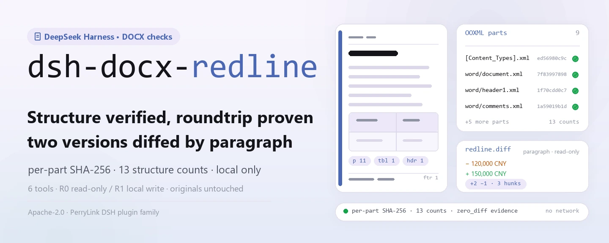
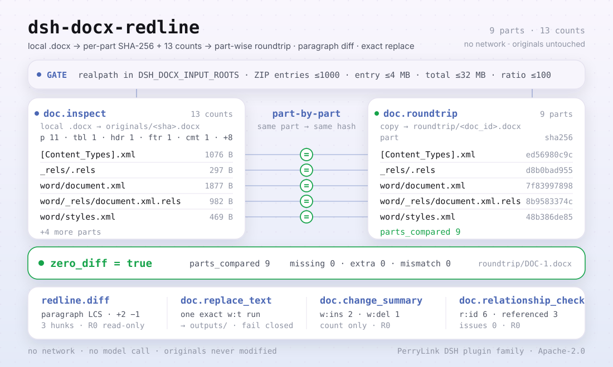

<div align="center">

<picture>
  <source media="(prefers-color-scheme: dark)" srcset="docs/assets/dsh-docx-redline-hero-en-dark.webp">
  
</picture>

# dsh-docx-redline

**Inspect DOCX structure, verify a part-wise identical roundtrip, and diff two versions paragraph by paragraph — entirely local, no network.**

A DOCX structure-inspection and text-diff plugin for DeepSeek Harness: it reads local `.docx` OOXML packages, returns per-part SHA-256 plus 13 structure counts, and adds roundtrip verification, revision summaries, relationship checks and single-run text replacement when you need them.

[Install](#three-step-setup) · [Configuration](#configuration) · [FAQ](#faq) · [简体中文](README.md) · [English](README.en.md) · [Español](README.es.md) · [Português](README.pt.md) · [हिन्दी](README.hi.md)

[](LICENSE)
[](#compatibility)
[](https://www.npmjs.com/package/dsh-docx-redline)
[](https://github.com/PerryLink/dsh-docx-redline/actions/workflows/ci.yml)
[](#compatibility)

[](https://github.com/PerryLink/dsh-docx-redline/stargazers)
[](https://www.npmjs.com/package/dsh-docx-redline)
[](https://dshfind.com/plugins/PerryLink/dsh-docx-redline?ref=badge)
[](https://dsh.market/)
[](https://gitee.com/perrylink/dsh-docx-redline)

```sh
dsh plugin --profile <profile> add dsh-docx-redline
```

</div>

<sub>Community plugin, not affiliated with DeepSeek. Canonical repository: <https://github.com/PerryLink/dsh-docx-redline>; same-name repositories under other accounts are not affiliated. Apache-2.0; Gitee is a mirror.</sub>

> **Status: alpha / public-synthetic / partial / not counted / not GA; active again since 2026-11-01.** No customer evidence, customer data, or production-readiness claim.

## What it is

`dsh-docx-redline` reads a local `.docx` (an OOXML ZIP package) and returns per-part SHA-256 plus 13 structure counts. When needed it copies the package for a part-wise identical roundtrip check, performs a paragraph-level text diff between two inspected documents, counts `w:ins` / `w:del` revisions, checks package relationship integrity, and replaces one `w:t` text run under a **single exact match**. All six tools are namespaced `doc.` / `redline.`; there is no network access, no model call and no upload, and the original file is never modified.

- **Good for**: comparing body text between two versions of a contract or official document; confirming a received `.docx` is structurally complete (paragraphs, tables, headers/footers, comments, fields, bookmarks); replacing one piece of text inside a controlled boundary while keeping the original.
- **Not for**: producing tracked changes or accepting/rejecting revisions (this package writes no tracked changes); scanned PDFs or images; encrypted documents; `.doc` (97-2003 binary).

<picture>
  <source media="(prefers-color-scheme: dark)" srcset="docs/assets/dsh-docx-redline-flow-v5-dark.svg">
  
</picture>

## Three-step setup

1. **Install** (pick one channel):

   ```sh
   # npm channel (recommended, published releases)
   dsh plugin --profile <profile> add dsh-docx-redline
   # git channel (latest main; lib/ is not committed, run pnpm install && pnpm build first)
   dsh plugin --profile <profile> add github:PerryLink/dsh-docx-redline
   # tarball channel: pnpm pack in this repo, then
   dsh plugin --profile <profile> add ./dsh-docx-redline-<version>.tgz
   ```

   The npm package ships the built `lib/`; the git channel is a source snapshot with `lib/` gitignored — build before installing.

2. **Minimal config**: defaults work — `cordis.patch.yml` inserts a single row (`id: dsh-docx-redline`) and there are no Schemastery config keys; the only knobs are environment variables (see Configuration).

   ```yaml
   - insert:
       - id: dsh-docx-redline
         name: 'dsh-docx-redline'
   ```

3. **Verify it mounts**:

   ```sh
   dsh --profile <profile> --dump-config | grep dsh-docx-redline
   pnpm build && node samples/quickstart/run.mjs
   ```

   ```
   $ node samples/quickstart/run.mjs
   doc.inspect            DOC-1 parts=9 p=11 tbl=1 hdr=1 ftr=1 comments=1 fields=1 bookmarks=1 warnings=0
   doc.relationship_check relationships=6 referenced=3 external=1 issues=0
   doc.roundtrip          DOC-1 zero_diff=true parts_compared=9
   redline.diff           DOC-1 → DOC-2 added=2 removed=1 hunks=3
   ok: quickstart finished (6 tool calls, roundtrip byte-identical per part)
   ```

   `node samples/quickstart/run.mjs` runs the shipped synthetic contract through inspect → relationship_check → roundtrip → change_summary → diff and compares the result with the golden `samples/quickstart/expected/result.json`.

**Uninstall**: `dsh plugin --profile <profile> remove dsh-docx-redline` (or delete the row from the profile patch).

<details>
<summary>Install from the DSH Desktop marketplace</summary>

All PerryLink plugins can be browsed in the built-in DSH Desktop marketplace: **Marketplace → Sources → Add source → paste** `https://perrylink-dsh-catalog.perrylink.workers.dev/catalog-source.json` **→ select**. Installation still goes through the marketplace's npm identity check and your confirmation.

</details>

## Core capabilities

- **Structure inspection** — `doc.inspect` reads a local `.docx` ZIP/XML, stores the original, and returns per-part SHA-256 plus 13 counts: paragraphs, tables, table rows/cells, headers/footers, footnotes, comments, fields, bookmarks, numbered paragraphs, sections and styles. The same file is deduplicated by SHA-256, so a repeat inspection returns `existing: true`.
- **Part-wise roundtrip** — `doc.roundtrip` copies the package, unpacks input and output separately, and compares every part hash; it returns `zero_diff`, `parts_compared`, missing/extra parts and hash mismatches. It never compares a file with itself.
- **Paragraph-level diff** — `redline.diff` runs an LCS paragraph comparison over two inspected documents and returns added/removed paragraph counts plus ordered hunks; read-only, no OOXML writes and no Word tracked changes.
- **Revision summary** — `doc.change_summary` counts `w:ins` / `w:del` and the per-author distribution; it only counts and never accepts or rejects revisions.
- **Relationship integrity** — `doc.relationship_check` verifies that every `r:id` / `r:embed` / `r:link` in `document.xml` is declared in `document.xml.rels` and that internal target parts exist; external targets are counted separately. It reports, never repairs.
- **Limited replacement** — `doc.replace_text` replaces exactly one `w:t` run in `word/document.xml` and writes a new file under `outputs/`; zero or multiple matches and cross-run text fail closed, and the generated WML is validated before writing.
- **Local only** — the source contains no HTTP / DNS / WebSocket calls; no network, no model call, no upload, and originals are never modified.

### Tool surface

Tool names are the stable API (kept in English to match runtime output); descriptions are localized.

| Tool | Purpose | Risk |
|---|---|---|
| `doc.inspect` | Read a local `.docx` ZIP/XML, store the original, and return per-part SHA-256 plus structure counts (paragraphs, tables, table rows/cells, headers/footers, footnotes, comments, fields, bookmarks, numbered paragraphs, sections, styles) | R1 local write (stores original) |
| `doc.roundtrip` | Copy the package, unpack both sides and compare every part hash; return a part-wise identical report (`zero_diff` / `parts_compared` / missing / extra / hash mismatch) | R1 local write |
| `redline.diff` | Text-level paragraph diff (LCS) between two inspected documents: added/removed paragraphs and ordered hunks; no OOXML writing | R0 read-only |
| `doc.replace_text` | Replace one exact `w:t` text run in `word/document.xml` and write a new file under `outputs/`; fail closed when the text is not unique or spans runs | R1 local write |
| `doc.change_summary` | Count `w:ins` / `w:del` revisions and authors; no accept/reject | R0 read-only |
| `doc.relationship_check` | Check that `r:id` / `r:embed` / `r:link` are declared in `document.xml.rels` and internal target parts exist; report only, no repair | R0 read-only |

### Inputs & outputs

**Inputs**:

- A local `.docx` (OOXML ZIP package; saved by Word / WPS).
- Input roots are controlled by `DSH_DOCX_INPUT_ROOTS` (several entries separated by the platform path delimiter; defaults to the host process cwd). Paths are resolved with `realpath` and must stay inside a configured root.
- ZIP safety limits: ≤1000 entries, ≤4 MB per entry after decompression, ≤32 MB total uncompressed, compression ratio ≤100 (for entries above 1 MB); so a single file must be clearly below 32 MB uncompressed.
- Shipped samples: `samples/quickstart/input/contract-v1.docx` and `contract-v2.docx` (about 4 KB each; a synthetic contract with fictional parties and amounts, no customer document).

**Outputs**:

- Structure counts and per-part SHA-256, a roundtrip report, revision summaries, a paragraph-level diff, and a new `.docx` for replacements.
- Written under `$DSH_HOME/storages/dsh-docx-redline` (or `DSH_DOCX_HOME`): `originals/` (original copies named by sha256), `roundtrip/` (roundtrip copies) and `outputs/` (replacement artifacts).
- The original file is never modified.

### Examples

Paste this prompt to the assistant (English translation of the shipped demo prompt in `package.json`):

```text
Check the structure of the shipped sample contract, diff it against the final version, and tell me which paragraphs changed and how many revisions there are.
```

You can also run it yourself (a real run; the screenshot comes from this command):

```sh
pnpm build && node samples/quickstart/run.mjs
```


*Real command `node samples/quickstart/run.mjs` on the two shipped synthetic DOCX files: 6 tool calls. The image is a 1:1 render of `samples/quickstart/expected/console.txt`; nothing was re-typed.*

Fixture example: input [`fixtures/public/python-docx/blk-containing-table.docx`](https://github.com/PerryLink/dsh-docx-redline/blob/main/fixtures/public/python-docx/blk-containing-table.docx) (public MIT sample); command `pnpm test`.

Acceptance: `node scripts/acceptance.mjs` produces `ACCEPTANCE.csv` (6 rows; the SKU rows are `counted=false`, the shipped-sample row `PS1-QS01` is `counted=true`):

```csv
req_id,metric,threshold,actual,script,evidence_sha256,pass,source,counted
SKU-01-A01,无改动往返通过率（20 合成）,100%,1,scripts/acceptance.mjs,2140bb443d8d3b36790ba67eec101ca86f2754f530b428758a5ed7890a1b44cd,true,public/synthetic,false
SKU-01-A02,结构覆盖（6 类）,6/6,6,scripts/acceptance.mjs,2140bb443d8d3b36790ba67eec101ca86f2754f530b428758a5ed7890a1b44cd,true,public/synthetic,false
SKU-01-A03,畸形拒绝率（5 份）,100%,1,scripts/acceptance.mjs,2140bb443d8d3b36790ba67eec101ca86f2754f530b428758a5ed7890a1b44cd,true,public/synthetic,false
SKU-01-A04,修订统计（w:ins/w:del）,2/1,2/1,scripts/acceptance.mjs,2140bb443d8d3b36790ba67eec101ca86f2754f530b428758a5ed7890a1b44cd,true,public/synthetic,false
SKU-01-A05,OOXML 关系完整性,0 issues,0,scripts/acceptance.mjs,2140bb443d8d3b36790ba67eec101ca86f2754f530b428758a5ed7890a1b44cd,true,public/synthetic,false
PS1-QS01,quickstart 样例与金标一致,1/1,1,scripts/acceptance.mjs,1271d470260bec05ea4e2bf2916fb07305e9e4b540ebf65af17a9c9924dcda30,true,synthetic/quickstart,true
```

*The synthetic set contains 20 valid DOCX files (paragraphs, tables, headers/footers, footnotes, comments, fields, bookmarks, numbering, sections, styles) and 5 malformed packages; customer evidence is 0 pairs. See [`EVIDENCE.md`](EVIDENCE.md) and [`APPROVAL-AND-EVIDENCE.md`](APPROVAL-AND-EVIDENCE.md).*

## Configuration

This plugin has no Schemastery config keys: `cordis.patch.yml` inserts a single row and the defaults work. The knobs are environment variables:

| Key | Default | Meaning |
|---|---|---|
| `DSH_DOCX_HOME` | `$DSH_HOME/storages/dsh-docx-redline` | Storage root: `originals/`, `roundtrip/` and `outputs/` live here; falls back to `storages/dsh-docx-redline` under the host process cwd when `$DSH_HOME` is unset |
| `DSH_DOCX_INPUT_ROOTS` | host process cwd | Allowed input roots, several entries separated by `path.delimiter` (Windows `;`, POSIX `:`); validated with realpath |
| `DSH_HOME` | host process cwd | Only used to derive the default `DSH_DOCX_HOME`; ignored when `DSH_DOCX_HOME` is set explicitly |

<details>
<summary>Full mount surface and defaults</summary>

`cordis.patch.yml` (complete):

```yaml
- insert:
    - id: dsh-docx-redline
      name: 'dsh-docx-redline'
```

- The plugin declares `inject = ['tools', 'storageDomain']`: both services must be present or the plugin does not mount; a missing `storageDomain` never degrades silently.
- Tools register on `ctx.tools`; `doc.inspect` writes the original, `doc.roundtrip` writes a copy and `doc.replace_text` writes `outputs/`; the other three tools are read-only.
- `doc_id` is created by `doc.inspect` and stored in the session's `docx` domain `documents` table; a new session or an inspection you skipped leaves no such record.

</details>

## FAQ

<details>
<summary>It will not install or mount. What now?</summary>

Check that `node --version` is ≥24.9 and <25 and that `dsh --version` is within `>=0.2.1-rc.3 <0.4.0`, then run `dsh plugin --profile <profile> add dsh-docx-redline`. The host must provide both `tools` and `storageDomain` (hard dependency), otherwise the plugin does not mount. The full error table is in [`TROUBLESHOOTING.md`](TROUBLESHOOTING.md).

</details>

<details>
<summary>Can it damage my document?</summary>

No original writes. `doc.inspect` only copies the original into `originals/`, `doc.roundtrip` only writes a `roundtrip/` copy and `doc.replace_text` only writes a new file under `outputs/`. Replacement requires the target text to be **unique** in `word/document.xml`; zero or multiple matches and cross-run text fail closed, and the generated WML is validated before writing.

</details>

<details>
<summary>Does it handle .doc, PDF, encrypted documents or scans?</summary>

No. Only standard `.docx` (OOXML ZIP package, saved by Word/WPS) is supported; `.doc` (97-2003 binary), PDF, encrypted documents and image-only scans are out of scope. Remove the password first, or save other formats as `.docx`.

</details>

<details>
<summary>The result looks wrong, or it warns about missing headers/footers. Why?</summary>

Check `warnings` first: a missing header/footer part, fields, bookmarks, numbering or comments is reported individually. The diff is **paragraph-level text**, not character-level revisions; deleted text (`w:delText`) is not part of the current body. `doc.relationship_check` only reports `E_DOC_REL_UNRESOLVED` / `E_DOC_REL_MISSING_PART` and does not repair — opening and re-saving in Word usually fixes the relationships.

</details>

<details>
<summary>Where is my data stored? Is anything uploaded?</summary>

Only `$DSH_HOME/storages/dsh-docx-redline` (or `DSH_DOCX_HOME`): original copies, roundtrip copies and `outputs/*.docx`. The source has no network calls; nothing is uploaded and no model is called. The repository contains only public/synthetic fixtures, no customer data.

</details>

## Security boundaries

- **Read scope**: only the `.docx` files you explicitly pass under `DSH_DOCX_INPUT_ROOTS` (default cwd); paths are `realpath`-resolved and checked, and an escape returns `E_DOC_PATH_NOT_ALLOWED`.
- **Write scope**: only the `dsh-docx-redline` storage root (`originals/`, `roundtrip/`, `outputs/`); originals are never modified.
- **No network**: no HTTP / DNS / WebSocket calls in the source; no external systems and no upload.
- **ZIP-bomb guard**: every read goes through `safeUnzip()` with pre-decompression limits (>1000 entries, >4 MB per entry, >32 MB uncompressed, ratio >100 → `E_DOC_ZIP_LIMIT`), and actual sizes are re-checked after inflate.
- **Fail-closed replacement**: `doc.replace_text` accepts only a single exact match; function-form replacement keeps `$&`, `$1` and similar patterns literal; the generated WML is validated with `XMLValidator` / `XMLParser` and rejected before writing when invalid.
- **Roundtrip proof**: `doc.roundtrip` unpacks both input and output and compares every part hash instead of comparing a package with itself.
- **Evidence hashes**: original SHA-256, per-part SHA-256 and the record-level `evidence_sha256` are all reproducible.
- **Risk levels**: tools that write are R1 (local write), read-only tools are R0; see the tool table under Core capabilities.
- **Read-only relationship check**: `doc.relationship_check` returns issues and never modifies the package.

## Permissions & data

```text
read: only the .docx files you name under the input roots; no other directory traversal
write: $DSH_HOME/storages/dsh-docx-redline (originals, roundtrip copies, outputs/*.docx); originals untouched
network: no
external systems: none
```

- Runs locally; no network, no model call, no upload.
- Public/synthetic fixtures only; no customer data or customer evidence.
- Alpha / partial; not counted, no GA or production-readiness claim.
- Actively maintained: work resumed on 2026-11-01; new features and hardening land in alpha releases.

## Known limitations

- **Public/synthetic validation only.** Alpha / partial / not counted / not GA; customer evidence is 0 real double-version DOCX pairs and 0 malformed DOCX files, and E2 doc-core is not shipped. This establishes no customer accuracy, Word/LibreOffice fidelity, redline position accuracy or GA readiness.
- **Text-level, not character-level.** `redline.diff` compares paragraphs as text, not character-level revisions; deleted text (`w:delText`) is not part of the current body.
- **No tracked changes.** It does not generate Word tracked changes and does not accept or reject revisions; `doc.change_summary` only counts `w:ins` / `w:del`.
- **Narrow replacement surface.** `doc.replace_text` handles a single exact `w:t` run; non-unique text, zero matches and cross-run text all fail; comments and fields outside the matched text are left untouched.
- **Relationship check does not repair.** `doc.relationship_check` only reports undeclared references and missing targets; repairing requires a Word re-save or editing the package.
- **Format limits.** No `.doc` (97-2003 binary), PDF, encrypted documents, scans or images; remove the password from encrypted files first.
- **ZIP limits.** ≤1000 entries, ≤4 MB per entry after decompression, ≤32 MB uncompressed, compression ratio ≤100 (for entries above 1 MB); oversized documents must be split first.
- **Input-root limit.** Tools read only files under `DSH_DOCX_INPUT_ROOTS` (default cwd); an out-of-root path is rejected.
- **No UI/client half.** A pure host plugin with no browser UI, preview or comments panel; every result is returned through tool output.

## Compatibility

| Surface | Status |
|---|---|
| Harness | `dsh >=0.2.1-rc.3 <0.4.0` |
| Node | `>=24.9.0 <25` |
| Platforms | Anywhere DSH runs; local files only |
| Data | No network, no model call, no upload |

## Ecosystem & quality

- [Gitee mirror](https://gitee.com/perrylink/dsh-docx-redline) (synchronized mirror; GitHub is canonical)
- [dshfind plugin page](https://dshfind.com/plugins/PerryLink/dsh-docx-redline) (installs and ranking)
- [DSH Market](https://dsh.market/) (listed)
- **1024 store channel**: run `npm i -g dsh1024`, then `dsh1024 plugin --profile <profile> add dsh-docx-redline` (counts toward the [deepseek1024.com](https://deepseek1024.com) install ranking)
- Docs: [`TROUBLESHOOTING.md`](TROUBLESHOOTING.md) · [`PRIVACY.md`](PRIVACY.md) · [`SECURITY.md`](SECURITY.md) · [`ACCEPTANCE.csv`](ACCEPTANCE.csv) · [`EVIDENCE.md`](EVIDENCE.md) · [`APPROVAL-AND-EVIDENCE.md`](APPROVAL-AND-EVIDENCE.md)
- Family indexes: [domain index](https://perrylink.github.io/dsh-plugins/) · [checker family](https://perrylink.github.io/zh/checkers/) · [mainline family](https://github.com/PerryLink/dsh-kit)
- Sibling packages: [dsh-ifc-qto](https://github.com/PerryLink/dsh-ifc-qto) · [dsh-legal-clause](https://github.com/PerryLink/dsh-legal-clause) · [dsh-contract-suite](https://github.com/PerryLink/dsh-contract-suite)

Related checkers (each is a separate package with its own rule pack and version; install only the ones you need):

| Package | Why it is relevant |
|---|---|
| [`dsh-gongwen-word-check`](https://github.com/PerryLink/dsh-gongwen-word-check) | Official-document formatting elements. |
| [`dsh-archive-check`](https://github.com/PerryLink/dsh-archive-check) | Archive filing register and retention periods. |
| [`dsh-paper-doc-adapter`](https://github.com/PerryLink/dsh-paper-doc-adapter) | Parsed exam-paper structural consistency. |

## Development

```sh
pnpm install --frozen-lockfile
pnpm build && pnpm lint && pnpm typecheck && pnpm test
pnpm run gate:sku01
node scripts/acceptance.mjs
pnpm run pack:check
node samples/quickstart/run.mjs
```

`pnpm test` builds with `tsc` and then runs `node --test test/*.test.mjs` (docx / public-docx / change-summary / relationships / security / plugin-smoke). `pnpm run gate:sku01` and `scripts/acceptance.mjs` produce/check the acceptance rows.

| Path | Content |
|---|---|
| `src/core/docx.ts` | Types, error codes and ZIP safety limit constants |
| `src/adapters/docx-zip.ts` | OOXML ZIP reads, structure parsing, per-part hashes, replacement, revision summary, relationship check |
| `src/plugin/index.ts` | Host entry: reads env vars, opens the `docx` domain, registers the six tools |
| `src/plugin/storage.ts` | `docx` storage domain (`documents` table) and original-file storage |
| `src/plugin/tools.ts` | Definitions of the six tools |
| `test/` | `node --test` cases |
| `fixtures/public/python-docx/` | 8 public MIT-licensed DOCX samples (with LICENSE / SOURCE) |
| `samples/quickstart/` | Synthetic contract v1/v2, run script and golden output |
| `scripts/` | lint, acceptance, gate, pack check, sample generation and image generator |
| `docs/assets/` | Hero WebPs, structure SVGs and real run captures |

The hero and the structure diagram are generated by [`scripts/gen-readme-assets.py`](scripts/gen-readme-assets.py) (Python + Pillow for the hero WebP, hand-written SVG for the structure diagram) and can be re-run; `quickstart.png` is a 1:1 render of `samples/quickstart/expected/console.txt`.

Topics: `deepseek-harness`, `dsh`, `dsh-plugin`, `docx`, `redline`, `docx-inspect`, `perrylink`, `ooxml`, `document`

## Family & thanks

This project is a member of the DeepSeek Harness plugin family maintained by [PerryLink](https://github.com/PerryLink) (all Apache-2.0). If this plugin helps you, **give it a star** — it unlocks nothing, but it makes the next person more likely to find it.

- [@PerryLink](https://github.com/PerryLink) — creator and maintainer: OOXML structure reading, part-wise hash roundtrip, paragraph-level diff, limited `w:t` replacement, revision summaries, package relationship checks and five-language docs.

## License

[LICENSE](LICENSE) (Apache License 2.0) © 2026 PerryLink; see also `NOTICE` and `THIRD-PARTY-NOTICES`.

<p align="center"><sub>Apache-2.0 · community plugin, not affiliated with DeepSeek.</sub></p>
