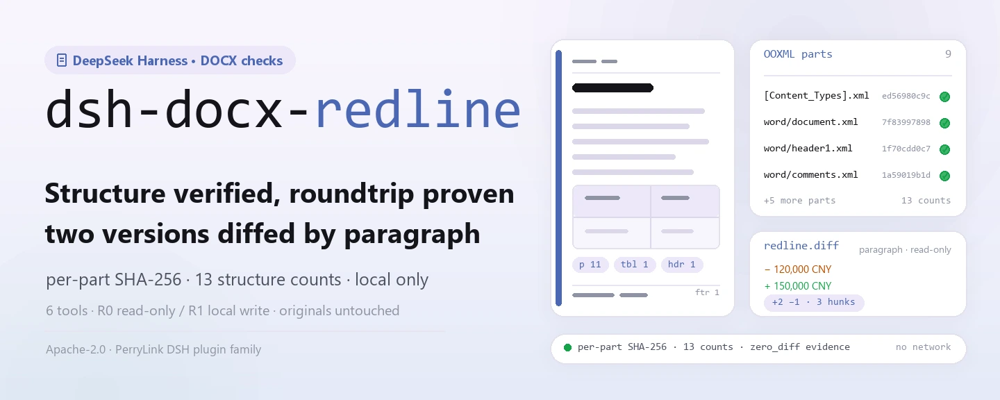
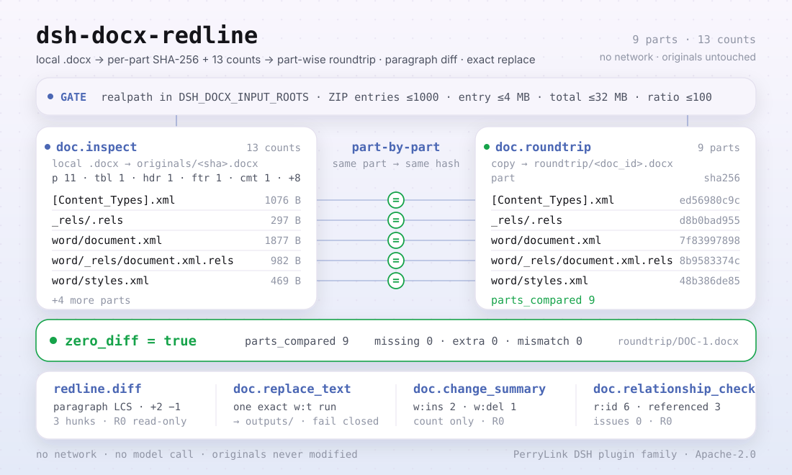

<div align="center">

<picture>
  <source media="(prefers-color-scheme: dark)" srcset="docs/assets/dsh-docx-redline-hero-en-dark.webp">
  
</picture>

# dsh-docx-redline

**Inspecciona la estructura de un DOCX, verifica un roundtrip idéntico parte por parte y compara dos versiones párrafo a párrafo — todo local, sin red.**

Un plugin de inspección de estructura DOCX y diff de texto para DeepSeek Harness: lee paquetes OOXML `.docx` locales, devuelve SHA-256 por parte y 13 recuentos de estructura, y añade verificación de roundtrip, resumen de revisiones, comprobación de relaciones y reemplazo de texto en una sola ejecución cuando hace falta.

[Instalar](#instalación-en-tres-pasos) · [Configuración](#configuración) · [FAQ](#faq) · [简体中文](README.md) · [English](README.en.md) · [Español](README.es.md) · [Português](README.pt.md) · [हिन्दी](README.hi.md)

[](LICENSE)
[](#compatibilidad)
[](https://www.npmjs.com/package/dsh-docx-redline)
[](https://github.com/PerryLink/dsh-docx-redline/actions/workflows/ci.yml)
[](#compatibilidad)

[](https://github.com/PerryLink/dsh-docx-redline/stargazers)
[](https://www.npmjs.com/package/dsh-docx-redline)
[](https://dshfind.com/plugins/PerryLink/dsh-docx-redline?ref=badge)
[](https://dsh.market/)
[](https://gitee.com/perrylink/dsh-docx-redline)

```sh
dsh plugin --profile <profile> add dsh-docx-redline
```

</div>

<sub>Plugin de la comunidad, no afiliado a DeepSeek. Repositorio canónico: <https://github.com/PerryLink/dsh-docx-redline>; los repositorios con el mismo nombre en otras cuentas no están afiliados. Apache-2.0; Gitee es un espejo.</sub>

> **Estado: alpha / sintético público / parcial / no contabilizado / no GA; activo de nuevo desde 2026-11-01.** Sin evidencia de clientes, datos de clientes ni promesa de producción.

## Qué es

`dsh-docx-redline` lee un `.docx` local (un paquete ZIP OOXML) y devuelve SHA-256 por parte más 13 recuentos de estructura. Cuando hace falta, copia el paquete para una verificación de roundtrip idéntica parte por parte, hace un diff de texto a nivel de párrafo entre dos documentos inspeccionados, cuenta revisiones `w:ins` / `w:del`, comprueba la integridad de las relaciones del paquete y reemplaza un run `w:t` bajo una **única coincidencia exacta**. Las seis herramientas llevan namespace `doc.` / `redline.`; no hay red, ni llamada a modelo, ni subida de datos, y el archivo original nunca se modifica.

- **Adecuado para**: comparar el cuerpo de dos versiones de un contrato o documento oficial; confirmar que un `.docx` recibido está estructuralmente completo (párrafos, tablas, encabezados/pies, comentarios, campos, marcadores); reemplazar un texto dentro de un límite controlado conservando el original.
- **No adecuado para**: producir control de cambios o aceptar/rechazar revisiones (este paquete no escribe tracked changes); PDF escaneados o imágenes; documentos cifrados; `.doc` (binario 97-2003).

<picture>
  <source media="(prefers-color-scheme: dark)" srcset="docs/assets/dsh-docx-redline-flow-v5-dark.svg">
  
</picture>

## Instalación en tres pasos

1. **Instala** (elige un canal):

   ```sh
   # canal npm (recomendado, versiones publicadas)
   dsh plugin --profile <profile> add dsh-docx-redline
   # canal git (último main; lib/ no se versiona, ejecuta antes pnpm install && pnpm build)
   dsh plugin --profile <profile> add github:PerryLink/dsh-docx-redline
   # canal tarball: pnpm pack en este repo y luego
   dsh plugin --profile <profile> add ./dsh-docx-redline-<version>.tgz
   ```

   El paquete npm incluye `lib/` ya construido; el canal git es una instantánea del código con `lib/` en gitignore: construye antes de instalar.

2. **Configuración mínima**: los valores por defecto funcionan — `cordis.patch.yml` inserta una sola fila (`id: dsh-docx-redline`) y no hay claves de configuración Schemastery; solo hay variables de entorno (ver Configuración).

   ```yaml
   - insert:
       - id: dsh-docx-redline
         name: 'dsh-docx-redline'
   ```

3. **Verifica que se monta**:

   ```sh
   dsh --profile <profile> --dump-config | grep dsh-docx-redline
   pnpm build && node samples/quickstart/run.mjs
   ```

   ```
   $ node samples/quickstart/run.mjs
   doc.inspect            DOC-1 parts=9 p=11 tbl=1 hdr=1 ftr=1 comments=1 fields=1 bookmarks=1 warnings=0
   doc.relationship_check relationships=6 referenced=3 external=1 issues=0
   doc.roundtrip          DOC-1 zero_diff=true parts_compared=9
   redline.diff           DOC-1 → DOC-2 added=2 removed=1 hunks=3
   ok: quickstart finished (6 tool calls, roundtrip byte-identical per part)
   ```

   `node samples/quickstart/run.mjs` ejecuta el contrato sintético incluido por inspect → relationship_check → roundtrip → change_summary → diff y compara con el resultado de referencia `samples/quickstart/expected/result.json`.

**Desinstalar**: `dsh plugin --profile <profile> remove dsh-docx-redline` (o borra la fila del patch del profile).

<details>
<summary>Instalar desde el marketplace de DSH Desktop</summary>

Todos los plugins de PerryLink se pueden explorar en el marketplace integrado de DSH Desktop: **Marketplace → Fuentes → Añadir fuente → pega** `https://perrylink-dsh-catalog.perrylink.workers.dev/catalog-source.json` **→ selecciona**. La instalación sigue pasando por la verificación de identidad npm del marketplace y tu confirmación.

</details>

## Capacidades clave

- **Inspección de estructura** — `doc.inspect` lee un `.docx` ZIP/XML local, guarda el original y devuelve SHA-256 por parte más 13 recuentos: párrafos, tablas, filas/celdas de tabla, encabezados/pies, notas al pie, comentarios, campos, marcadores, párrafos numerados, secciones y estilos. El mismo archivo se deduplica por SHA-256, así que una inspección repetida devuelve `existing: true`.
- **Roundtrip parte por parte** — `doc.roundtrip` copia el paquete, descomprime entrada y salida por separado y compara el hash de cada parte; devuelve `zero_diff`, `parts_compared`, partes faltantes/sobrantes y discrepancias de hash. Nunca compara un archivo consigo mismo.
- **Diff a nivel de párrafo** — `redline.diff` hace una comparación LCS de párrafos entre dos documentos inspeccionados y devuelve los recuentos de añadidos/eliminados y hunks ordenados; solo lectura, sin escritura OOXML y sin tracked changes de Word.
- **Resumen de revisiones** — `doc.change_summary` cuenta `w:ins` / `w:del` y la distribución por autor; solo cuenta, nunca acepta ni rechaza revisiones.
- **Integridad de relaciones** — `doc.relationship_check` verifica que cada `r:id` / `r:embed` / `r:link` de `document.xml` esté declarado en `document.xml.rels` y que existan las partes internas de destino; los destinos externos se cuentan aparte. Solo informa, nunca repara.
- **Reemplazo limitado** — `doc.replace_text` reemplaza exactamente un run `w:t` de `word/document.xml` y escribe un archivo nuevo en `outputs/`; cero o varias coincidencias y texto repartido entre runs fallan de forma segura, y el WML generado se valida antes de escribir.
- **Solo local** — el código no contiene llamadas HTTP / DNS / WebSocket; sin red, sin modelo, sin subida, y los originales nunca se modifican.

### Superficie de herramientas

Los nombres de herramientas son la API estable (se mantienen en inglés para coincidir con la salida del runtime); las descripciones están localizadas.

| Herramienta | Propósito | Riesgo |
|---|---|---|
| `doc.inspect` | Leer un `.docx` ZIP/XML local, guardar el original y devolver SHA-256 por parte más recuentos de estructura (párrafos, tablas, filas/celdas, encabezados/pies, notas al pie, comentarios, campos, marcadores, párrafos numerados, secciones, estilos) | R1 escritura local (guarda el original) |
| `doc.roundtrip` | Copiar el paquete, descomprimir ambos lados y comparar el hash de cada parte; devolver un informe idéntico parte por parte (`zero_diff` / `parts_compared` / faltantes / sobrantes / hash distinto) | R1 escritura local |
| `redline.diff` | Diff de párrafos a nivel de texto (LCS) entre dos documentos inspeccionados: párrafos añadidos/eliminados y hunks ordenados; sin escritura OOXML | R0 solo lectura |
| `doc.replace_text` | Reemplazar un run `w:t` exacto en `word/document.xml` y escribir un archivo nuevo en `outputs/`; fallar de forma segura si el texto no es único o abarca varios runs | R1 escritura local |
| `doc.change_summary` | Contar revisiones `w:ins` / `w:del` y autores; sin aceptar/rechazar | R0 solo lectura |
| `doc.relationship_check` | Comprobar que `r:id` / `r:embed` / `r:link` están declarados en `document.xml.rels` y que existen las partes internas; solo informa, sin reparar | R0 solo lectura |

### Entradas y salidas

**Entradas**:

- Un `.docx` local (paquete ZIP OOXML; guardado por Word / WPS).
- Las raíces de entrada se controlan con `DSH_DOCX_INPUT_ROOTS` (varias entradas separadas por el delimitador de rutas de la plataforma; por defecto el cwd del proceso host). Las rutas se resuelven con `realpath` y deben quedar dentro de una raíz configurada.
- Límites de seguridad ZIP: ≤1000 entradas, ≤4 MB por entrada tras descomprimir, ≤32 MB sin comprimir en total, ratio de compresión ≤100 (para entradas de más de 1 MB); por tanto, un archivo debe quedar claramente por debajo de 32 MB descomprimido.
- Muestras incluidas: `samples/quickstart/input/contract-v1.docx` y `contract-v2.docx` (unos 4 KB cada una; contrato sintético con partes y montos ficticios, sin documento de cliente).

**Salidas**:

- Recuentos de estructura y SHA-256 por parte, informe de roundtrip, resumen de revisiones, diff por párrafos y un `.docx` nuevo para los reemplazos.
- Se escriben bajo `$DSH_HOME/storages/dsh-docx-redline` (o `DSH_DOCX_HOME`): `originals/` (copias del original nombradas por sha256), `roundtrip/` (copias del roundtrip) y `outputs/` (artefactos de reemplazo).
- El archivo original nunca se modifica.

### Ejemplos

Pega este prompt al asistente (traducción al español del prompt de demostración incluido en `package.json`):

```text
Revisa la estructura del contrato de ejemplo incluido, compáralo con la versión final y dime qué párrafos cambiaron y cuántas revisiones hay.
```

También puedes ejecutarlo tú mismo (ejecución real; la captura viene de este comando):

```sh
pnpm build && node samples/quickstart/run.mjs
```


*Comando real `node samples/quickstart/run.mjs` sobre los dos DOCX sintéticos incluidos: 6 llamadas a herramientas. La imagen es un render 1:1 de `samples/quickstart/expected/console.txt`; no se reescribió nada.*

Ejemplo con fixture: entrada [`fixtures/public/python-docx/blk-containing-table.docx`](https://github.com/PerryLink/dsh-docx-redline/blob/main/fixtures/public/python-docx/blk-containing-table.docx) (muestra pública MIT); comando `pnpm test`.

Aceptación: `node scripts/acceptance.mjs` genera `ACCEPTANCE.csv` (6 filas; las filas SKU son `counted=false`, la fila de la muestra incluida `PS1-QS01` es `counted=true`):

```csv
req_id,metric,threshold,actual,script,evidence_sha256,pass,source,counted
SKU-01-A01,无改动往返通过率（20 合成）,100%,1,scripts/acceptance.mjs,2140bb443d8d3b36790ba67eec101ca86f2754f530b428758a5ed7890a1b44cd,true,public/synthetic,false
SKU-01-A02,结构覆盖（6 类）,6/6,6,scripts/acceptance.mjs,2140bb443d8d3b36790ba67eec101ca86f2754f530b428758a5ed7890a1b44cd,true,public/synthetic,false
SKU-01-A03,畸形拒绝率（5 份）,100%,1,scripts/acceptance.mjs,2140bb443d8d3b36790ba67eec101ca86f2754f530b428758a5ed7890a1b44cd,true,public/synthetic,false
SKU-01-A04,修订统计（w:ins/w:del）,2/1,2/1,scripts/acceptance.mjs,2140bb443d8d3b36790ba67eec101ca86f2754f530b428758a5ed7890a1b44cd,true,public/synthetic,false
SKU-01-A05,OOXML 关系完整性,0 issues,0,scripts/acceptance.mjs,2140bb443d8d3b36790ba67eec101ca86f2754f530b428758a5ed7890a1b44cd,true,public/synthetic,false
PS1-QS01,quickstart 样例与金标一致,1/1,1,scripts/acceptance.mjs,1271d470260bec05ea4e2bf2916fb07305e9e4b540ebf65af17a9c9924dcda30,true,synthetic/quickstart,true
```

*El conjunto sintético contiene 20 DOCX válidos (párrafos, tablas, encabezados/pies, notas al pie, comentarios, campos, marcadores, numeración, secciones, estilos) y 5 paquetes malformados; la evidencia de cliente es de 0 pares. Ver [`EVIDENCE.md`](EVIDENCE.md) y [`APPROVAL-AND-EVIDENCE.md`](APPROVAL-AND-EVIDENCE.md).*

## Configuración

Este plugin no tiene claves de configuración Schemastery: `cordis.patch.yml` inserta una sola fila y los valores por defecto funcionan. Los ajustes son variables de entorno:

| Clave | Valor por defecto | Significado |
|---|---|---|
| `DSH_DOCX_HOME` | `$DSH_HOME/storages/dsh-docx-redline` | Raíz de almacenamiento: aquí viven `originals/`, `roundtrip/` y `outputs/`; si `$DSH_HOME` no está definido, cae en `storages/dsh-docx-redline` bajo el cwd del proceso host |
| `DSH_DOCX_INPUT_ROOTS` | cwd del proceso host | Raíces de entrada permitidas, varias separadas por `path.delimiter` (Windows `;`, POSIX `:`); se validan con realpath |
| `DSH_HOME` | cwd del proceso host | Solo se usa para derivar el `DSH_DOCX_HOME` por defecto; se ignora si `DSH_DOCX_HOME` está definido explícitamente |

<details>
<summary>Superficie de montaje y valores por defecto</summary>

`cordis.patch.yml` (completo):

```yaml
- insert:
    - id: dsh-docx-redline
      name: 'dsh-docx-redline'
```

- El plugin declara `inject = ['tools', 'storageDomain']`: ambos servicios deben estar presentes o el plugin no se monta; un `storageDomain` ausente nunca degrada en silencio.
- Las herramientas se registran en `ctx.tools`; `doc.inspect` escribe el original, `doc.roundtrip` escribe una copia y `doc.replace_text` escribe en `outputs/`; las otras tres son de solo lectura.
- `doc_id` lo crea `doc.inspect` y se guarda en la tabla `documents` del dominio `docx` de la sesión; una sesión nueva o una inspección omitida dejan ese registro inexistente.

</details>

## FAQ

<details>
<summary>No se instala o no se monta. ¿Qué hago?</summary>

Comprueba que `node --version` sea ≥24.9 y <25 y que `dsh --version` esté dentro de `>=0.2.1-rc.3 <0.4.0`; después ejecuta `dsh plugin --profile <profile> add dsh-docx-redline`. El host debe aportar `tools` y `storageDomain` (dependencia dura); si falta uno, el plugin no se monta. La tabla completa de errores está en [`TROUBLESHOOTING.md`](TROUBLESHOOTING.md).

</details>

<details>
<summary>¿Puede dañar mi documento?</summary>

No se escribe el original. `doc.inspect` solo copia el original en `originals/`, `doc.roundtrip` solo escribe una copia en `roundtrip/` y `doc.replace_text` solo escribe un archivo nuevo en `outputs/`. El reemplazo exige que el texto objetivo sea **único** en `word/document.xml`; cero o varias coincidencias y texto repartido entre runs fallan de forma segura, y el WML generado se valida antes de escribir.

</details>

<details>
<summary>¿Admite .doc, PDF, documentos cifrados o escaneos?</summary>

No. Solo se admite `.docx` estándar (paquete ZIP OOXML, guardado por Word/WPS); `.doc` (binario 97-2003), PDF, documentos cifrados y escaneos de solo imagen quedan fuera. Quita la contraseña primero o guarda otros formatos como `.docx`.

</details>

<details>
<summary>El resultado no cuadra o avisa de encabezados/pies ausentes. ¿Por qué?</summary>

Mira primero `warnings`: la ausencia de encabezado/pie, campos, marcadores, numeración o comentarios se informa por separado. El diff es de **texto a nivel de párrafo**, no revisiones a nivel de carácter; el texto eliminado (`w:delText`) no forma parte del cuerpo actual. `doc.relationship_check` solo informa `E_DOC_REL_UNRESOLVED` / `E_DOC_REL_MISSING_PART` y no repara — abrir y volver a guardar en Word suele corregir las relaciones.

</details>

<details>
<summary>¿Dónde se guardan mis datos? ¿Se sube algo?</summary>

Solo en `$DSH_HOME/storages/dsh-docx-redline` (o `DSH_DOCX_HOME`): copias del original, copias del roundtrip y `outputs/*.docx`. El código no hace llamadas de red; no se sube nada ni se llama a un modelo. El repositorio solo contiene fixtures públicas/sintéticas, sin datos de clientes.

</details>

## Límites de seguridad

- **Alcance de lectura**: solo los `.docx` que pasas explícitamente dentro de `DSH_DOCX_INPUT_ROOTS` (cwd por defecto); las rutas se resuelven con `realpath` y se comprueban, y una salida devuelve `E_DOC_PATH_NOT_ALLOWED`.
- **Alcance de escritura**: solo la raíz de almacenamiento de `dsh-docx-redline` (`originals/`, `roundtrip/`, `outputs/`); los originales nunca se modifican.
- **Sin red**: no hay llamadas HTTP / DNS / WebSocket en el código; sin sistemas externos y sin subida.
- **Protección contra ZIP bombs**: cada lectura pasa por `safeUnzip()` con límites previos a la descompresión (>1000 entradas, >4 MB por entrada, >32 MB sin comprimir, ratio >100 → `E_DOC_ZIP_LIMIT`), y los tamaños reales se revisan tras inflar.
- **Reemplazo fail-closed**: `doc.replace_text` acepta solo una coincidencia exacta; el reemplazo en forma de función mantiene `$&`, `$1` y similares como literales; el WML generado se valida con `XMLValidator` / `XMLParser` y se rechaza antes de escribir si no es válido.
- **Prueba de roundtrip**: `doc.roundtrip` descomprime entrada y salida y compara el hash de cada parte en vez de comparar un paquete consigo mismo.
- **Hashes de evidencia**: el SHA-256 del original, el SHA-256 por parte y el `evidence_sha256` del registro son reproducibles.
- **Niveles de riesgo**: las herramientas que escriben son R1 (escritura local); las de solo lectura son R0; ver la tabla de herramientas en Capacidades clave.
- **Comprobación de relaciones de solo lectura**: `doc.relationship_check` devuelve issues y nunca modifica el paquete.

## Permisos y datos

```text
lectura: solo los .docx que indicas dentro de las raíces de entrada; sin recorrer otros directorios
escritura: $DSH_HOME/storages/dsh-docx-redline (originales, copias de roundtrip, outputs/*.docx); original intacto
red: no
sistemas externos: ninguno
```

- Se ejecuta localmente; sin red, sin llamada a modelo, sin subida.
- Solo fixtures públicas/sintéticas; sin datos ni evidencia de clientes.
- Alpha / parcial; no contabilizado, sin GA ni promesa de producción.
- Mantenimiento activo: trabajo reanudado el 2026-11-01; nuevas funciones y endurecimiento llegan en versiones alpha.

## Limitaciones conocidas

- **Solo validación pública/sintética.** Alpha / parcial / no contabilizado / no GA; la evidencia de cliente es de 0 pares reales de DOCX de doble versión y 0 DOCX malformados, y E2 doc-core no se entrega. No establece precisión con clientes, fidelidad Word/LibreOffice, precisión de posición de revisiones ni preparación GA.
- **Nivel de texto, no de carácter.** `redline.diff` compara párrafos como texto, no revisiones carácter a carácter; el texto eliminado (`w:delText`) no forma parte del cuerpo actual.
- **Sin tracked changes.** No genera control de cambios de Word ni acepta/rechaza revisiones; `doc.change_summary` solo cuenta `w:ins` / `w:del`.
- **Superficie de reemplazo estrecha.** `doc.replace_text` trabaja con un único run `w:t` exacto; texto no único, cero coincidencias y texto repartido entre runs fallan; los comentarios y campos fuera del texto coincidente quedan intactos.
- **La comprobación de relaciones no repara.** `doc.relationship_check` solo informa referencias no declaradas y destinos ausentes; reparar requiere volver a guardar en Word o editar el paquete.
- **Límites de formato.** Sin `.doc` (binario 97-2003), PDF, documentos cifrados, escaneos ni imágenes; quita antes la contraseña de los archivos cifrados.
- **Límites ZIP.** ≤1000 entradas, ≤4 MB por entrada tras descomprimir, ≤32 MB sin comprimir, ratio ≤100 (para entradas de más de 1 MB); los documentos enormes deben dividirse antes.
- **Límite de raíz de entrada.** Las herramientas solo leen archivos bajo `DSH_DOCX_INPUT_ROOTS` (cwd por defecto); una ruta fuera de la raíz se rechaza.
- **Sin UI ni mitad cliente.** Plugin puro de host, sin interfaz de navegador, vista previa ni panel de comentarios; todos los resultados se devuelven por la salida de las herramientas.

## Compatibilidad

| Superficie | Estado |
|---|---|
| Harness | `dsh >=0.2.1-rc.3 <0.4.0` |
| Node | `>=24.9.0 <25` |
| Plataformas | Donde corra DSH; solo archivos locales |
| Datos | Sin red, sin llamada a modelo, sin subida |

## Ecosistema y calidad

- [Espejo Gitee](https://gitee.com/perrylink/dsh-docx-redline) (espejo sincronizado; GitHub es canónico)
- [Página dshfind](https://dshfind.com/plugins/PerryLink/dsh-docx-redline) (instalaciones y ranking)
- [DSH Market](https://dsh.market/) (publicado)
- **Canal de la tienda 1024**: ejecuta `npm i -g dsh1024` y luego `dsh1024 plugin --profile <profile> add dsh-docx-redline` (cuenta para el ranking de [deepseek1024.com](https://deepseek1024.com))
- Documentación: [`TROUBLESHOOTING.md`](TROUBLESHOOTING.md) · [`PRIVACY.md`](PRIVACY.md) · [`SECURITY.md`](SECURITY.md) · [`ACCEPTANCE.csv`](ACCEPTANCE.csv) · [`EVIDENCE.md`](EVIDENCE.md) · [`APPROVAL-AND-EVIDENCE.md`](APPROVAL-AND-EVIDENCE.md)
- Índices de familia: [índice de dominio](https://perrylink.github.io/dsh-plugins/) · [familia de checkers](https://perrylink.github.io/zh/checkers/) · [familia principal](https://github.com/PerryLink/dsh-kit)
- Paquetes hermanos: [dsh-ifc-qto](https://github.com/PerryLink/dsh-ifc-qto) · [dsh-legal-clause](https://github.com/PerryLink/dsh-legal-clause) · [dsh-contract-suite](https://github.com/PerryLink/dsh-contract-suite)

Verificadores relacionados (cada uno es un paquete independiente con su propio rule pack y versión; instala solo los que necesites):

| Paquete | Por qué es relevante |
|---|---|
| [`dsh-gongwen-word-check`](https://github.com/PerryLink/dsh-gongwen-word-check) | Elementos de formato de documentos oficiales. |
| [`dsh-archive-check`](https://github.com/PerryLink/dsh-archive-check) | Registro de archivo y plazos de conservación. |
| [`dsh-paper-doc-adapter`](https://github.com/PerryLink/dsh-paper-doc-adapter) | Consistencia estructural de exámenes parseados. |

## Desarrollo

```sh
pnpm install --frozen-lockfile
pnpm build && pnpm lint && pnpm typecheck && pnpm test
pnpm run gate:sku01
node scripts/acceptance.mjs
pnpm run pack:check
node samples/quickstart/run.mjs
```

`pnpm test` construye con `tsc` y luego ejecuta `node --test test/*.test.mjs` (docx / public-docx / change-summary / relationships / security / plugin-smoke). `pnpm run gate:sku01` y `scripts/acceptance.mjs` producen/comprueban las filas de aceptación.

| Ruta | Contenido |
|---|---|
| `src/core/docx.ts` | Tipos, códigos de error y constantes de límites ZIP |
| `src/adapters/docx-zip.ts` | Lectura OOXML ZIP, parseo de estructura, hashes por parte, reemplazo, resumen de revisiones, comprobación de relaciones |
| `src/plugin/index.ts` | Entrada host: lee variables de entorno, abre el dominio `docx`, registra las seis herramientas |
| `src/plugin/storage.ts` | Dominio de almacenamiento `docx` (tabla `documents`) y guardado del original |
| `src/plugin/tools.ts` | Definiciones de las seis herramientas |
| `test/` | Casos de `node --test` |
| `fixtures/public/python-docx/` | 8 muestras DOCX públicas con licencia MIT (con LICENSE / SOURCE) |
| `samples/quickstart/` | Contrato sintético v1/v2, script de ejecución y salida de referencia |
| `scripts/` | lint, aceptación, gate, comprobación de pack, generación de muestras e imágenes |
| `docs/assets/` | WebP del hero, SVG de estructura y capturas reales |

El hero y el diagrama de estructura los genera [`scripts/gen-readme-assets.py`](scripts/gen-readme-assets.py) (Python + Pillow para el hero WebP, SVG escrito a mano para el diagrama) y se pueden volver a ejecutar; `quickstart.png` es un render 1:1 de `samples/quickstart/expected/console.txt`.

Topics: `deepseek-harness`, `dsh`, `dsh-plugin`, `docx`, `redline`, `docx-inspect`, `perrylink`, `ooxml`, `document`

## Familia y agradecimientos

Este proyecto es miembro de la familia de plugins de DeepSeek Harness mantenida por [PerryLink](https://github.com/PerryLink) (todos Apache-2.0). Si este plugin te ayuda, **dale una estrella**: no desbloquea nada, pero hace que la siguiente persona lo encuentre más fácilmente.

- [@PerryLink](https://github.com/PerryLink) — creador y mantenedor: lectura de estructura OOXML, roundtrip con hash por parte, diff por párrafos, reemplazo limitado de `w:t`, resumen de revisiones, comprobación de relaciones del paquete y documentación en cinco idiomas.

## Licencia

[LICENSE](LICENSE) (Apache License 2.0) © 2026 PerryLink; ver también `NOTICE` y `THIRD-PARTY-NOTICES`.

<p align="center"><sub>Apache-2.0 · plugin de la comunidad, no afiliado a DeepSeek.</sub></p>
