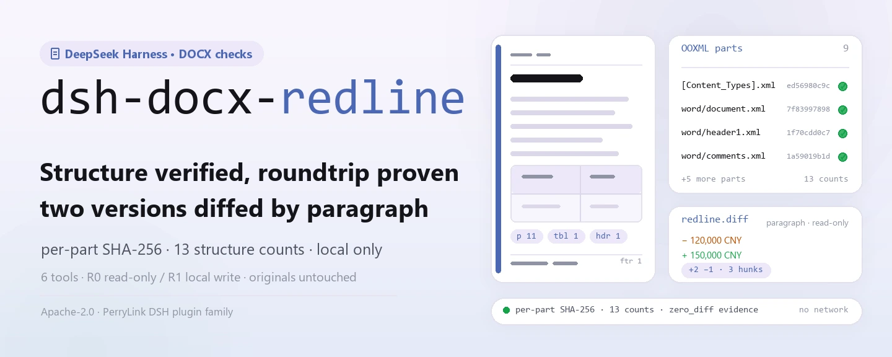
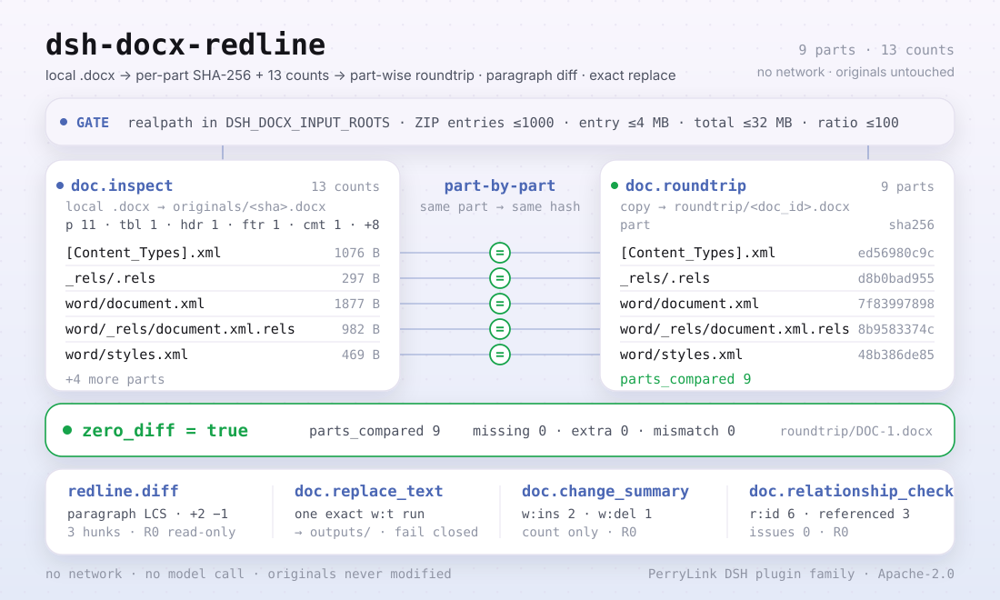

<div align="center">

<picture>
  <source media="(prefers-color-scheme: dark)" srcset="docs/assets/dsh-docx-redline-hero-en-dark.webp">
  
</picture>

# dsh-docx-redline

**DOCX संरचना जाँचें, हिस्सा-दर-हिस्सा समान राउंडट्रिप सत्यापित करें, और दो संस्करणों का पैराग्राफ़-दर-पैराग्राफ़ अंतर निकालें — पूरी तरह स्थानीय, बिना नेटवर्क।**

DeepSeek Harness के लिए DOCX संरचना-निरीक्षण और टेक्स्ट-डिफ़ प्लगइन: स्थानीय `.docx` OOXML पैकेज पढ़ता है, हिस्सा-दर-हिस्सा SHA-256 और 13 संरचना गणनाएँ लौटाता है, और ज़रूरत पड़ने पर राउंडट्रिप सत्यापन, संशोधन सारांश, रिलेशनशिप जाँच और एक ही रन में टेक्स्ट रिप्लेस जोड़ता है।

[इंस्टॉल](#तीन-चरणों-में-शुरुआत) · [कॉन्फ़िगरेशन](#कॉन्फ़िगरेशन) · [FAQ](#faq) · [简体中文](README.md) · [English](README.en.md) · [Español](README.es.md) · [Português](README.pt.md) · [हिन्दी](README.hi.md)

[](LICENSE)
[](#संगतता)
[](https://www.npmjs.com/package/dsh-docx-redline)
[](https://github.com/PerryLink/dsh-docx-redline/actions/workflows/ci.yml)
[](#संगतता)

[](https://github.com/PerryLink/dsh-docx-redline/stargazers)
[](https://www.npmjs.com/package/dsh-docx-redline)
[](https://dshfind.com/plugins/PerryLink/dsh-docx-redline?ref=badge)
[](https://dsh.market/)
[](https://gitee.com/perrylink/dsh-docx-redline)

```sh
dsh plugin --profile <profile> add dsh-docx-redline
```

</div>

<sub>सामुदायिक प्लगइन, DeepSeek से असंबद्ध। कैनोनिकल रिपॉज़िटरी: <https://github.com/PerryLink/dsh-docx-redline>; अन्य खातों की समान-नाम वाली रिपॉज़िटरी संबद्ध नहीं हैं। Apache-2.0; Gitee एक मिरर है।</sub>

> **स्थिति: alpha / सार्वजनिक-सिंथेटिक / आंशिक / गिना नहीं गया / GA नहीं; 2026-11-01 से फिर सक्रिय।** ग्राहक साक्ष्य, ग्राहक डेटा या उत्पादन-तैयारी का दावा नहीं।

## यह क्या है

`dsh-docx-redline` स्थानीय `.docx` (OOXML ZIP पैकेज) पढ़ता है और हिस्सा-दर-हिस्सा SHA-256 के साथ 13 संरचना गणनाएँ लौटाता है। ज़रूरत पड़ने पर यह पैकेज की प्रति बनाकर हिस्सा-दर-हिस्सा समान राउंडट्रिप जाँचता है, दो निरीक्षित दस्तावेज़ों का पैराग्राफ़-स्तरीय टेक्स्ट डिफ़ करता है, `w:ins` / `w:del` संशोधन गिनता है, पैकेज रिलेशनशिप की अखंडता जाँचता है, और **एकल सटीक मिलान** की शर्त पर एक `w:t` टेक्स्ट रन बदलता है। छहों टूल `doc.` / `redline.` नेमस्पेस में हैं; कोई नेटवर्क, कोई मॉडल कॉल, कोई अपलोड नहीं, और मूल फ़ाइल कभी नहीं बदलती।

- **किसके लिए उपयुक्त**: अनुबंध या सरकारी दस्तावेज़ के दो संस्करणों के मुख्य पाठ की तुलना; प्राप्त `.docx` की संरचना (पैराग्राफ़, तालिकाएँ, हेडर/फ़ुटर, टिप्पणियाँ, फ़ील्ड, बुकमार्क) पूरी है या नहीं, यह पुष्टि करना; मूल को सुरक्षित रखते हुए नियंत्रित सीमा में एक टेक्स्ट बदलना।
- **किसके लिए नहीं**: ट्रैक्ड चेंज बनाना या संशोधन स्वीकार/अस्वीकार करना (यह पैकेज tracked changes नहीं लिखता); स्कैन किए PDF या चित्र; एन्क्रिप्टेड दस्तावेज़; `.doc` (97-2003 बाइनरी)।

<picture>
  <source media="(prefers-color-scheme: dark)" srcset="docs/assets/dsh-docx-redline-flow-v5-dark.svg">
  
</picture>

## तीन चरणों में शुरुआत

1. **इंस्टॉल करें** (एक चैनल चुनें):

   ```sh
   # npm चैनल (अनुशंसित, प्रकाशित रिलीज़)
   dsh plugin --profile <profile> add dsh-docx-redline
   # git चैनल (नवीनतम main; lib/ वर्शन नहीं होता, पहले pnpm install && pnpm build चलाएँ)
   dsh plugin --profile <profile> add github:PerryLink/dsh-docx-redline
   # tarball चैनल: इस रेपो में pnpm pack करके
   dsh plugin --profile <profile> add ./dsh-docx-redline-<version>.tgz
   ```

   npm पैकेज में बना हुआ `lib/` शामिल है; git चैनल सोर्स स्नैपशॉट है जिसमें `lib/` gitignore में है — इंस्टॉल से पहले बिल्ड करें।

2. **न्यूनतम कॉन्फ़िग**: डिफ़ॉल्ट से ही चलता है — `cordis.patch.yml` केवल एक पंक्ति (`id: dsh-docx-redline`) डालता है और कोई Schemastery कॉन्फ़िग कुंजी नहीं है; एकमात्र समायोजन पर्यावरण चर हैं (कॉन्फ़िगरेशन देखें)।

   ```yaml
   - insert:
       - id: dsh-docx-redline
         name: 'dsh-docx-redline'
   ```

3. **माउंट सत्यापित करें**:

   ```sh
   dsh --profile <profile> --dump-config | grep dsh-docx-redline
   pnpm build && node samples/quickstart/run.mjs
   ```

   ```
   $ node samples/quickstart/run.mjs
   doc.inspect            DOC-1 parts=9 p=11 tbl=1 hdr=1 ftr=1 comments=1 fields=1 bookmarks=1 warnings=0
   doc.relationship_check relationships=6 referenced=3 external=1 issues=0
   doc.roundtrip          DOC-1 zero_diff=true parts_compared=9
   redline.diff           DOC-1 → DOC-2 added=2 removed=1 hunks=3
   ok: quickstart finished (6 tool calls, roundtrip byte-identical per part)
   ```

   `node samples/quickstart/run.mjs` साथ भेजे गए सिंथेटिक अनुबंध को inspect → relationship_check → roundtrip → change_summary → diff से चलाता है और परिणाम की तुलना गोल्डन `samples/quickstart/expected/result.json` से करता है।

**अनइंस्टॉल**: `dsh plugin --profile <profile> remove dsh-docx-redline` (या profile patch से वह पंक्ति हटाएँ)।

<details>
<summary>DSH Desktop मार्केटप्लेस से इंस्टॉल</summary>

सभी PerryLink प्लगइन DSH Desktop के अंतर्निहित मार्केटप्लेस में देखे जा सकते हैं: **Marketplace → Sources → Add source → चिपकाएँ** `https://perrylink-dsh-catalog.perrylink.workers.dev/catalog-source.json` **→ चुनें**। इंस्टॉल अब भी मार्केटप्लेस की npm पहचान जाँच और आपकी पुष्टि से होता है।

</details>

## मुख्य क्षमताएँ

- **संरचना निरीक्षण** — `doc.inspect` स्थानीय `.docx` ZIP/XML पढ़ता है, मूल प्रति संग्रहीत करता है, और हिस्सा-दर-हिस्सा SHA-256 के साथ 13 गणनाएँ लौटाता है: पैराग्राफ़, तालिकाएँ, तालिका पंक्तियाँ/सेल, हेडर/फ़ुटर, फ़ुटनोट, टिप्पणियाँ, फ़ील्ड, बुकमार्क, क्रमांकित पैराग्राफ़, सेक्शन और स्टाइल। एक ही फ़ाइल SHA-256 से डिडुप्लिकेट होती है, इसलिए दोबारा निरीक्षण `existing: true` लौटाता है।
- **हिस्सा-दर-हिस्सा राउंडट्रिप** — `doc.roundtrip` पैकेज की प्रति बनाता है, इनपुट और आउटपुट को अलग-अलग अनपैक करता है और हर हिस्से का हैश तुलना करता है; `zero_diff`, `parts_compared`, अनुपस्थित/अतिरिक्त हिस्से और हैश अंतर लौटाता है। यह किसी फ़ाइल की तुलना स्वयं से नहीं करता।
- **पैराग्राफ़-स्तरीय डिफ़** — `redline.diff` दो निरीक्षित दस्तावेज़ों पर LCS पैराग्राफ़ तुलना करता है और जोड़े/हटाए गए पैराग्राफ़ की संख्या तथा क्रमबद्ध hunks लौटाता है; केवल पढ़ने योग्य, कोई OOXML लेखन नहीं और कोई Word tracked changes नहीं।
- **संशोधन सारांश** — `doc.change_summary` `w:ins` / `w:del` और प्रति-लेखक वितरण गिनता है; केवल गिनता है, कभी स्वीकार/अस्वीकार नहीं करता।
- **रिलेशनशिप अखंडता** — `doc.relationship_check` जाँचता है कि `document.xml` का हर `r:id` / `r:embed` / `r:link` `document.xml.rels` में घोषित है और आंतरिक लक्ष्य हिस्से मौजूद हैं; बाहरी लक्ष्य अलग गिने जाते हैं। केवल रिपोर्ट करता है, कभी मरम्मत नहीं।
- **सीमित रिप्लेस** — `doc.replace_text` `word/document.xml` में ठीक एक `w:t` रन बदलता है और `outputs/` में नई फ़ाइल लिखता है; शून्य या कई मिलान और कई रन में फैला टेक्स्ट fail closed होते हैं, और लिखने से पहले बना WML मान्य किया जाता है।
- **केवल स्थानीय** — सोर्स में कोई HTTP / DNS / WebSocket कॉल नहीं; कोई नेटवर्क, मॉडल कॉल या अपलोड नहीं, और मूल प्रतियाँ कभी नहीं बदलतीं।

### टूल सतह

टूल नाम स्थिर API हैं (रनटाइम आउटपुट से मेल के लिए अंग्रेज़ी में रखे गए); विवरण स्थानीयकृत हैं।

| टूल | उद्देश्य | जोखिम |
|---|---|---|
| `doc.inspect` | स्थानीय `.docx` ZIP/XML पढ़ें, मूल प्रति संग्रहीत करें और हिस्सा-दर-हिस्सा SHA-256 तथा संरचना गणनाएँ लौटाएँ (पैराग्राफ़, तालिकाएँ, तालिका पंक्तियाँ/सेल, हेडर/फ़ुटर, फ़ुटनोट, टिप्पणियाँ, फ़ील्ड, बुकमार्क, क्रमांकित पैराग्राफ़, सेक्शन, स्टाइल) | R1 स्थानीय लेखन (मूल संग्रहीत) |
| `doc.roundtrip` | पैकेज की प्रति बनाएँ, दोनों पक्ष अनपैक करें और हर हिस्से का हैश तुलना करें; हिस्सा-दर-हिस्सा समान रिपोर्ट लौटाएँ (`zero_diff` / `parts_compared` / अनुपस्थित / अतिरिक्त / हैश अंतर) | R1 स्थानीय लेखन |
| `redline.diff` | दो निरीक्षित दस्तावेज़ों के बीच टेक्स्ट-स्तरीय पैराग्राफ़ डिफ़ (LCS): जोड़े/हटाए गए पैराग्राफ़ और क्रमबद्ध hunks; कोई OOXML लेखन नहीं | R0 केवल पढ़ना |
| `doc.replace_text` | `word/document.xml` में एक सटीक `w:t` रन बदलें और `outputs/` में नई फ़ाइल लिखें; टेक्स्ट अद्वितीय न हो या कई रन में फैला हो तो fail closed | R1 स्थानीय लेखन |
| `doc.change_summary` | `w:ins` / `w:del` संशोधन और लेखक गिनें; कोई स्वीकार/अस्वीकार नहीं | R0 केवल पढ़ना |
| `doc.relationship_check` | जाँचें कि `r:id` / `r:embed` / `r:link` `document.xml.rels` में घोषित हैं और आंतरिक लक्ष्य हिस्से मौजूद हैं; केवल रिपोर्ट, कोई मरम्मत नहीं | R0 केवल पढ़ना |

### इनपुट और आउटपुट

**इनपुट**:

- स्थानीय `.docx` (OOXML ZIP पैकेज; Word / WPS से सहेजा गया)।
- इनपुट रूट `DSH_DOCX_INPUT_ROOTS` से नियंत्रित होते हैं (कई प्रविष्टियाँ प्लेटफ़ॉर्म पाथ डिलिमिटर से अलग; डिफ़ॉल्ट होस्ट प्रोसेस cwd)। पाथ `realpath` से हल होते हैं और किसी कॉन्फ़िगर किए गए रूट के भीतर रहना चाहिए।
- ZIP सुरक्षा सीमाएँ: ≤1000 प्रविष्टियाँ, अनपैक के बाद प्रति प्रविष्टि ≤4 MB, कुल अनकंप्रेस्ड ≤32 MB, कंप्रेशन अनुपात ≤100 (1 MB से बड़ी प्रविष्टियों के लिए); इसलिए एक फ़ाइल अनपैक होने पर 32 MB से स्पष्ट रूप से कम होनी चाहिए।
- साथ भेजे गए नमूने: `samples/quickstart/input/contract-v1.docx` और `contract-v2.docx` (लगभग 4 KB प्रत्येक; काल्पनिक पक्षों और राशियों वाला सिंथेटिक अनुबंध, कोई ग्राहक दस्तावेज़ नहीं)।

**आउटपुट**:

- संरचना गणनाएँ और हिस्सा-दर-हिस्सा SHA-256, राउंडट्रिप रिपोर्ट, संशोधन सारांश, पैराग्राफ़-स्तरीय डिफ़ और रिप्लेस के लिए नई `.docx`।
- `$DSH_HOME/storages/dsh-docx-redline` (या `DSH_DOCX_HOME`) के अंतर्गत लिखे जाते हैं: `originals/` (sha256 से नामित मूल प्रतियाँ), `roundtrip/` (राउंडट्रिप प्रतियाँ) और `outputs/` (रिप्लेस आर्टिफ़ैक्ट)।
- मूल फ़ाइल कभी नहीं बदलती।

### उदाहरण

यह प्रॉम्प्ट सहायक को दें (`package.json` में शामिल डेमो प्रॉम्प्ट का हिन्दी अनुवाद):

```text
इस रेपो में शामिल नमूना अनुबंध की संरचना जाँचें, इसे अंतिम संस्करण से तुलना करें, और बताएँ कि कौन से पैराग्राफ़ बदले और कितने संशोधन हैं।
```

आप स्वयं भी चला सकते हैं (वास्तविक रन; स्क्रीनशॉट इसी कमांड से है):

```sh
pnpm build && node samples/quickstart/run.mjs
```


*वास्तविक कमांड `node samples/quickstart/run.mjs` साथ भेजे गए दो सिंथेटिक DOCX पर: 6 टूल कॉल। चित्र `samples/quickstart/expected/console.txt` का 1:1 रेंडर है; कुछ भी दोबारा टाइप नहीं किया गया।*

fixture उदाहरण: इनपुट [`fixtures/public/python-docx/blk-containing-table.docx`](https://github.com/PerryLink/dsh-docx-redline/blob/main/fixtures/public/python-docx/blk-containing-table.docx) (सार्वजनिक MIT नमूना); कमांड `pnpm test`।

स्वीकृति: `node scripts/acceptance.mjs` `ACCEPTANCE.csv` बनाता है (6 पंक्तियाँ; SKU पंक्तियाँ `counted=false`, साथ भेजी गई नमूना पंक्ति `PS1-QS01` `counted=true`):

```csv
req_id,metric,threshold,actual,script,evidence_sha256,pass,source,counted
SKU-01-A01,无改动往返通过率（20 合成）,100%,1,scripts/acceptance.mjs,2140bb443d8d3b36790ba67eec101ca86f2754f530b428758a5ed7890a1b44cd,true,public/synthetic,false
SKU-01-A02,结构覆盖（6 类）,6/6,6,scripts/acceptance.mjs,2140bb443d8d3b36790ba67eec101ca86f2754f530b428758a5ed7890a1b44cd,true,public/synthetic,false
SKU-01-A03,畸形拒绝率（5 份）,100%,1,scripts/acceptance.mjs,2140bb443d8d3b36790ba67eec101ca86f2754f530b428758a5ed7890a1b44cd,true,public/synthetic,false
SKU-01-A04,修订统计（w:ins/w:del）,2/1,2/1,scripts/acceptance.mjs,2140bb443d8d3b36790ba67eec101ca86f2754f530b428758a5ed7890a1b44cd,true,public/synthetic,false
SKU-01-A05,OOXML 关系完整性,0 issues,0,scripts/acceptance.mjs,2140bb443d8d3b36790ba67eec101ca86f2754f530b428758a5ed7890a1b44cd,true,public/synthetic,false
PS1-QS01,quickstart 样例与金标一致,1/1,1,scripts/acceptance.mjs,1271d470260bec05ea4e2bf2916fb07305e9e4b540ebf65af17a9c9924dcda30,true,synthetic/quickstart,true
```

*सिंथेटिक सेट में 20 वैध DOCX (पैराग्राफ़, तालिकाएँ, हेडर/फ़ुटर, फ़ुटनोट, टिप्पणियाँ, फ़ील्ड, बुकमार्क, नंबरिंग, सेक्शन, स्टाइल) और 5 विकृत पैकेज हैं; ग्राहक साक्ष्य 0 जोड़े हैं। देखें [`EVIDENCE.md`](EVIDENCE.md) और [`APPROVAL-AND-EVIDENCE.md`](APPROVAL-AND-EVIDENCE.md)।*

## कॉन्फ़िगरेशन

इस प्लगइन में कोई Schemastery कॉन्फ़िग कुंजी नहीं है: `cordis.patch.yml` एक ही पंक्ति डालता है और डिफ़ॉल्ट से चलता है। समायोजन पर्यावरण चर हैं:

| कुंजी | डिफ़ॉल्ट | अर्थ |
|---|---|---|
| `DSH_DOCX_HOME` | `$DSH_HOME/storages/dsh-docx-redline` | स्टोरेज रूट: `originals/`, `roundtrip/` और `outputs/` यहीं रहते हैं; `$DSH_HOME` सेट न हो तो होस्ट प्रोसेस cwd के अंतर्गत `storages/dsh-docx-redline` पर गिरता है |
| `DSH_DOCX_INPUT_ROOTS` | होस्ट प्रोसेस cwd | अनुमत इनपुट रूट, कई प्रविष्टियाँ `path.delimiter` से अलग (Windows `;`, POSIX `:`); realpath से मान्य |
| `DSH_HOME` | होस्ट प्रोसेस cwd | केवल डिफ़ॉल्ट `DSH_DOCX_HOME` निकालने के लिए; `DSH_DOCX_HOME` स्पष्ट रूप से सेट हो तो अनदेखा |

<details>
<summary>पूरी माउंट सतह और डिफ़ॉल्ट</summary>

`cordis.patch.yml` (पूरा):

```yaml
- insert:
    - id: dsh-docx-redline
      name: 'dsh-docx-redline'
```

- प्लगइन `inject = ['tools', 'storageDomain']` घोषित करता है: दोनों सेवाएँ मौजूद होनी चाहिए, वरना प्लगइन माउंट नहीं होता; `storageDomain` की अनुपस्थिति कभी चुपचाप डिग्रेड नहीं होती।
- टूल `ctx.tools` पर रजिस्टर होते हैं; `doc.inspect` मूल लिखता है, `doc.roundtrip` प्रति लिखता है और `doc.replace_text` `outputs/` में लिखता है; बाकी तीन केवल पढ़ने योग्य हैं।
- `doc_id` `doc.inspect` बनाता है और सत्र के `docx` डोमेन की `documents` तालिका में रखा जाता है; नया सत्र या छोड़ा गया निरीक्षण उस रिकॉर्ड को अनुपस्थित छोड़ देता है।

</details>

## FAQ

<details>
<summary>इंस्टॉल या माउंट नहीं हो रहा। क्या करें?</summary>

देखें कि `node --version` ≥24.9 और <25 है, और `dsh --version` `>=0.2.1-rc.3 <0.4.0` के भीतर है; फिर `dsh plugin --profile <profile> add dsh-docx-redline` चलाएँ। होस्ट को `tools` और `storageDomain` दोनों देना होंगे (हार्ड डिपेंडेंसी); एक भी न हो तो प्लगइन माउंट नहीं होता। पूरी त्रुटि तालिका [`TROUBLESHOOTING.md`](TROUBLESHOOTING.md) में है।

</details>

<details>
<summary>क्या यह मेरा दस्तावेज़ खराब कर सकता है?</summary>

मूल पर कोई लेखन नहीं। `doc.inspect` केवल मूल की प्रति `originals/` में रखता है, `doc.roundtrip` केवल `roundtrip/` में प्रति लिखता है और `doc.replace_text` केवल `outputs/` में नई फ़ाइल लिखता है। रिप्लेस के लिए लक्ष्य टेक्स्ट का `word/document.xml` में **अद्वितीय** होना ज़रूरी है; शून्य या कई मिलान और कई रन में फैला टेक्स्ट fail closed होते हैं, और लिखने से पहले बना WML मान्य किया जाता है।

</details>

<details>
<summary>क्या .doc, PDF, एन्क्रिप्टेड दस्तावेज़ या स्कैन संभालता है?</summary>

नहीं। केवल मानक `.docx` (OOXML ZIP पैकेज, Word/WPS से सहेजा) समर्थित है; `.doc` (97-2003 बाइनरी), PDF, एन्क्रिप्टेड दस्तावेज़ और केवल-चित्र स्कैन दायरे से बाहर हैं। पहले पासवर्ड हटाएँ या अन्य फ़ॉर्मैट को `.docx` के रूप में सहेजें।

</details>

<details>
<summary>परिणाम गलत लगता है, या हेडर/फ़ुटर अनुपस्थित होने की चेतावनी आती है। क्यों?</summary>

पहले `warnings` देखें: हेडर/फ़ुटर हिस्सा, फ़ील्ड, बुकमार्क, नंबरिंग या टिप्पणियाँ न होने की सूचना अलग-अलग दी जाती है। डिफ़ **पैराग्राफ़-स्तरीय टेक्स्ट** है, अक्षर-स्तरीय संशोधन नहीं; हटाया गया टेक्स्ट (`w:delText`) वर्तमान मुख्य भाग में नहीं आता। `doc.relationship_check` केवल `E_DOC_REL_UNRESOLVED` / `E_DOC_REL_MISSING_PART` बताता है और मरम्मत नहीं करता — Word में खोलकर दोबारा सहेजना अक्सर रिलेशनशिप ठीक कर देता है।

</details>

<details>
<summary>मेरा डेटा कहाँ रहता है? कुछ अपलोड होता है?</summary>

केवल `$DSH_HOME/storages/dsh-docx-redline` (या `DSH_DOCX_HOME`) में: मूल प्रतियाँ, राउंडट्रिप प्रतियाँ और `outputs/*.docx`। सोर्स में कोई नेटवर्क कॉल नहीं; कुछ अपलोड नहीं होता और कोई मॉडल नहीं बुलाया जाता। रेपो में केवल सार्वजनिक/सिंथेटिक fixtures हैं, ग्राहक डेटा नहीं।

</details>

## सुरक्षा सीमाएँ

- **पढ़ने का दायरा**: केवल वे `.docx` जो आप `DSH_DOCX_INPUT_ROOTS` (डिफ़ॉल्ट cwd) के भीतर स्पष्ट रूप से देते हैं; पाथ `realpath` से हल और जाँचे जाते हैं, और सीमा से बाहर निकलने पर `E_DOC_PATH_NOT_ALLOWED` मिलता है।
- **लिखने का दायरा**: केवल `dsh-docx-redline` का स्टोरेज रूट (`originals/`, `roundtrip/`, `outputs/`); मूल प्रतियाँ कभी नहीं बदलतीं।
- **कोई नेटवर्क नहीं**: सोर्स में कोई HTTP / DNS / WebSocket कॉल नहीं; कोई बाहरी सिस्टम नहीं और कोई अपलोड नहीं।
- **ZIP-बम सुरक्षा**: हर पढ़ाई `safeUnzip()` से होती है जिसमें अनपैक से पहले सीमाएँ हैं (>1000 प्रविष्टियाँ, >4 MB प्रति प्रविष्टि, >32 MB अनकंप्रेस्ड, अनुपात >100 → `E_DOC_ZIP_LIMIT`), और inflate के बाद वास्तविक आकार फिर जाँचे जाते हैं।
- **fail-closed रिप्लेस**: `doc.replace_text` केवल एक सटीक मिलान स्वीकार करता है; फ़ंक्शन-रूप रिप्लेस `$&`, `$1` जैसे पैटर्न को शाब्दिक रखता है; बना WML `XMLValidator` / `XMLParser` से मान्य होता है और अमान्य होने पर लिखने से पहले अस्वीकार होता है।
- **राउंडट्रिप प्रमाण**: `doc.roundtrip` इनपुट और आउटपुट दोनों अनपैक करके हर हिस्से का हैश तुलना करता है, पैकेज की तुलना स्वयं से नहीं।
- **साक्ष्य हैश**: मूल SHA-256, हिस्सा-दर-हिस्सा SHA-256 और रिकॉर्ड-स्तरीय `evidence_sha256` सभी दोबारा जाँचे जा सकते हैं।
- **जोखिम स्तर**: लिखने वाले टूल R1 (स्थानीय लेखन), केवल-पढ़ने वाले R0; टूल तालिका मुख्य क्षमताएँ में देखें।
- **रिलेशनशिप जाँच केवल पढ़ना**: `doc.relationship_check` issues लौटाता है और पैकेज कभी नहीं बदलता।

## अनुमतियाँ और डेटा

```text
पढ़ना: इनपुट रूट के भीतर आपके द्वारा बताई गई .docx फ़ाइलें ही; अन्य डायरेक्टरी नहीं
लिखना: $DSH_HOME/storages/dsh-docx-redline (originals, roundtrip प्रतियाँ, outputs/*.docx); मूल अपरिवर्तित
नेटवर्क: नहीं
बाहरी सिस्टम: कोई नहीं
```

- स्थानीय रूप से चलता है; नेटवर्क, मॉडल कॉल या अपलोड नहीं।
- केवल सार्वजनिक/सिंथेटिक fixtures; ग्राहक डेटा या साक्ष्य नहीं।
- alpha / आंशिक; गिना नहीं गया, GA या उत्पादन-तैयारी का दावा नहीं।
- सक्रिय रखरखाव: 2026-11-01 से काम फिर शुरू; नई सुविधाएँ और हार्डनिंग alpha रिलीज़ में आती हैं।

## ज्ञात सीमाएँ

- **केवल सार्वजनिक/सिंथेटिक सत्यापन।** alpha / आंशिक / गिना नहीं गया / GA नहीं; ग्राहक साक्ष्य 0 वास्तविक दो-संस्करण DOCX जोड़े और 0 विकृत DOCX हैं, और E2 doc-core नहीं भेजा गया। यह ग्राहक सटीकता, Word/LibreOffice निष्ठा, संशोधन-स्थिति सटीकता या GA तैयारी सिद्ध नहीं करता।
- **टेक्स्ट-स्तर, अक्षर-स्तर नहीं।** `redline.diff` पैराग्राफ़ों की टेक्स्ट के रूप में तुलना करता है, अक्षर-स्तरीय संशोधन नहीं; हटाया गया टेक्स्ट (`w:delText`) वर्तमान मुख्य भाग में नहीं आता।
- **कोई tracked changes नहीं।** Word tracked changes नहीं बनाता और संशोधन स्वीकार/अस्वीकार नहीं करता; `doc.change_summary` केवल `w:ins` / `w:del` गिनता है।
- **रिप्लेस की सतह संकीर्ण।** `doc.replace_text` एक सटीक `w:t` रन पर काम करता है; गैर-अद्वितीय टेक्स्ट, शून्य मिलान और कई रन में फैला टेक्स्ट विफल होते हैं; मिले टेक्स्ट के बाहर की टिप्पणियाँ और फ़ील्ड जैसे हैं वैसे रहते हैं।
- **रिलेशनशिप जाँच मरम्मत नहीं करती।** `doc.relationship_check` केवल अनघोषित संदर्भ और अनुपस्थित लक्ष्य बताता है; मरम्मत के लिए Word में दोबारा सहेजना या पैकेज संपादित करना पड़ता है।
- **फ़ॉर्मैट सीमाएँ।** `.doc` (97-2003 बाइनरी), PDF, एन्क्रिप्टेड दस्तावेज़, स्कैन या चित्र नहीं; एन्क्रिप्टेड फ़ाइलों से पहले पासवर्ड हटाएँ।
- **ZIP सीमाएँ।** ≤1000 प्रविष्टियाँ, अनपैक के बाद प्रति प्रविष्टि ≤4 MB, अनकंप्रेस्ड ≤32 MB, अनुपात ≤100 (1 MB से बड़ी प्रविष्टियों के लिए); बहुत बड़े दस्तावेज़ पहले विभाजित करें।
- **इनपुट-रूट सीमा।** टूल केवल `DSH_DOCX_INPUT_ROOTS` (डिफ़ॉल्ट cwd) के अंतर्गत फ़ाइलें पढ़ते हैं; रूट से बाहर का पाथ अस्वीकार होता है।
- **कोई UI/क्लाइंट आधा नहीं।** शुद्ध host प्लगइन, कोई ब्राउज़र UI, प्रीव्यू या टिप्पणी पैनल नहीं; सभी परिणाम टूल आउटपुट से लौटते हैं।

## संगतता

| सतह | स्थिति |
|---|---|
| Harness | `dsh >=0.2.1-rc.3 <0.4.0` |
| Node | `>=24.9.0 <25` |
| प्लेटफ़ॉर्म | जहाँ DSH चले; केवल स्थानीय फ़ाइलें |
| डेटा | कोई नेटवर्क नहीं, कोई मॉडल कॉल नहीं, कोई अपलोड नहीं |

## इकोसिस्टम और गुणवत्ता

- [Gitee मिरर](https://gitee.com/perrylink/dsh-docx-redline) (सिंक किया गया मिरर; GitHub कैनोनिकल है)
- [dshfind प्लगइन पेज](https://dshfind.com/plugins/PerryLink/dsh-docx-redline) (इंस्टॉल और रैंकिंग)
- [DSH Market](https://dsh.market/) (सूचीबद्ध)
- **1024 स्टोर चैनल**: `npm i -g dsh1024` चलाएँ, फिर `dsh1024 plugin --profile <profile> add dsh-docx-redline` (यह [deepseek1024.com](https://deepseek1024.com) इंस्टॉल रैंकिंग में गिना जाता है)
- दस्तावेज़: [`TROUBLESHOOTING.md`](TROUBLESHOOTING.md) · [`PRIVACY.md`](PRIVACY.md) · [`SECURITY.md`](SECURITY.md) · [`ACCEPTANCE.csv`](ACCEPTANCE.csv) · [`EVIDENCE.md`](EVIDENCE.md) · [`APPROVAL-AND-EVIDENCE.md`](APPROVAL-AND-EVIDENCE.md)
- फ़ैमिली इंडेक्स: [डोमेन इंडेक्स](https://perrylink.github.io/dsh-plugins/) · [चेकर फ़ैमिली](https://perrylink.github.io/zh/checkers/) · [मुख्य फ़ैमिली](https://github.com/PerryLink/dsh-kit)
- सहोदर पैकेज: [dsh-ifc-qto](https://github.com/PerryLink/dsh-ifc-qto) · [dsh-legal-clause](https://github.com/PerryLink/dsh-legal-clause) · [dsh-contract-suite](https://github.com/PerryLink/dsh-contract-suite)

संबंधित चेकर (हर एक अलग पैकेज है, अपने rule pack और वर्शन के साथ; केवल ज़रूरी वाले इंस्टॉल करें):

| पैकेज | क्यों प्रासंगिक है |
|---|---|
| [`dsh-gongwen-word-check`](https://github.com/PerryLink/dsh-gongwen-word-check) | सरकारी दस्तावेज़ के फ़ॉर्मैटिंग तत्व। |
| [`dsh-archive-check`](https://github.com/PerryLink/dsh-archive-check) | आर्काइव पंजीकरण और संरक्षण अवधि। |
| [`dsh-paper-doc-adapter`](https://github.com/PerryLink/dsh-paper-doc-adapter) | पार्स किए गए प्रश्नपत्र की संरचनात्मक संगति। |

## डेवलपमेंट

```sh
pnpm install --frozen-lockfile
pnpm build && pnpm lint && pnpm typecheck && pnpm test
pnpm run gate:sku01
node scripts/acceptance.mjs
pnpm run pack:check
node samples/quickstart/run.mjs
```

`pnpm test` पहले `tsc` से बिल्ड करता है और फिर `node --test test/*.test.mjs` चलाता है (docx / public-docx / change-summary / relationships / security / plugin-smoke)। `pnpm run gate:sku01` और `scripts/acceptance.mjs` स्वीकृति पंक्तियाँ बनाते/जाँचते हैं।

| पाथ | सामग्री |
|---|---|
| `src/core/docx.ts` | टाइप, त्रुटि कोड और ZIP सुरक्षा सीमा स्थिरांक |
| `src/adapters/docx-zip.ts` | OOXML ZIP पढ़ाई, संरचना पार्सिंग, हिस्सा-दर-हिस्सा हैश, रिप्लेस, संशोधन सारांश, रिलेशनशिप जाँच |
| `src/plugin/index.ts` | Host प्रवेश: पर्यावरण चर पढ़ता है, `docx` डोमेन खोलता है, छह टूल रजिस्टर करता है |
| `src/plugin/storage.ts` | `docx` स्टोरेज डोमेन (`documents` तालिका) और मूल फ़ाइल संग्रहण |
| `src/plugin/tools.ts` | छह टूल की परिभाषाएँ |
| `test/` | `node --test` केस |
| `fixtures/public/python-docx/` | 8 सार्वजनिक MIT-लाइसेंस DOCX नमूने (LICENSE / SOURCE के साथ) |
| `samples/quickstart/` | सिंथेटिक अनुबंध v1/v2, रन स्क्रिप्ट और गोल्डन आउटपुट |
| `scripts/` | lint, स्वीकृति, gate, pack जाँच, नमूना निर्माण और चित्र जनरेटर |
| `docs/assets/` | hero WebP, संरचना SVG और वास्तविक रन कैप्चर |

हेडर hero और संरचना डायग्राम [`scripts/gen-readme-assets.py`](scripts/gen-readme-assets.py) से बनते हैं (Python + Pillow से hero WebP, संरचना डायग्राम के लिए हाथ से लिखा SVG) और दोबारा चलाए जा सकते हैं; `quickstart.png` `samples/quickstart/expected/console.txt` का 1:1 रेंडर है।

Topics: `deepseek-harness`, `dsh`, `dsh-plugin`, `docx`, `redline`, `docx-inspect`, `perrylink`, `ooxml`, `document`

## परिवार और आभार

यह परियोजना [PerryLink](https://github.com/PerryLink) द्वारा अनुरक्षित DeepSeek Harness प्लगइन परिवार की सदस्य है (सभी Apache-2.0)। अगर यह प्लगइन आपकी मदद करे, तो **एक स्टार दें** — इससे कोई सुविधा अनलॉक नहीं होती, पर अगला व्यक्ति इसे आसानी से खोज पाता है।

- [@PerryLink](https://github.com/PerryLink) — निर्माता और अनुरक्षक: OOXML संरचना पढ़ाई, हिस्सा-दर-हिस्सा हैश राउंडट्रिप, पैराग्राफ़-स्तरीय डिफ़, सीमित `w:t` रिप्लेस, संशोधन सारांश, पैकेज रिलेशनशिप जाँच और पाँच-भाषा दस्तावेज़।

## लाइसेंस

[LICENSE](LICENSE) (Apache License 2.0) © 2026 PerryLink; `NOTICE` और `THIRD-PARTY-NOTICES` भी देखें।

<p align="center"><sub>Apache-2.0 · सामुदायिक प्लगइन, DeepSeek से असंबद्ध।</sub></p>
