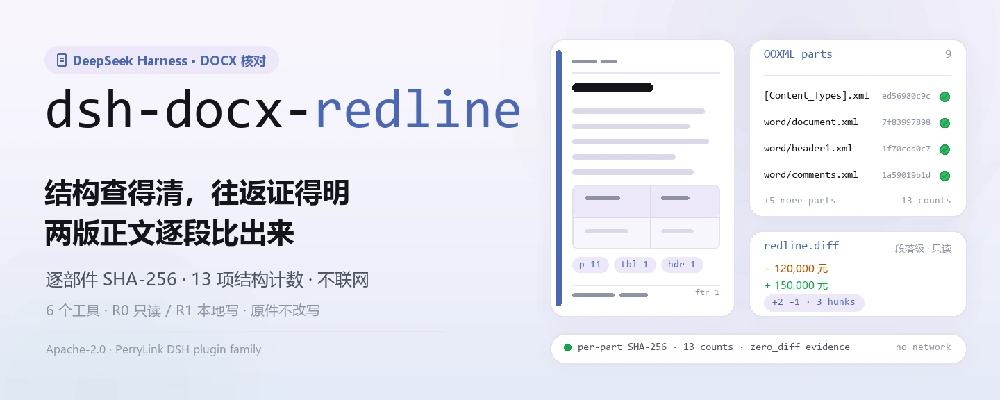
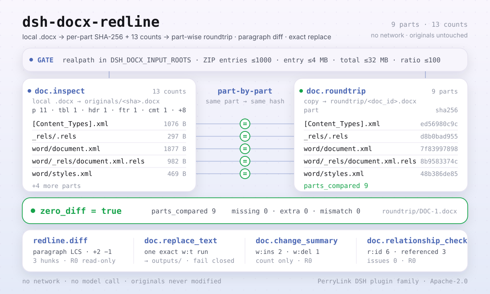

<div align="center">

<picture>
  <source media="(prefers-color-scheme: dark)" srcset="docs/assets/dsh-docx-redline-hero-zh-dark.webp">
  
</picture>

# dsh-docx-redline

**核对 Word 文档结构、验证逐部件一致往返，并把两版正文改动逐段比出来——全程本地，不联网。**

面向 DeepSeek Harness 的 DOCX 结构检查与文本级比对插件：读本地 `.docx` 的 OOXML 包，返回逐部件 SHA-256 与 13 项结构计数，并在需要时做往返校验、修订统计、关系检查与单 run 文本替换。

[安装](#三步上手) · [配置](#配置) · [FAQ](#faq) · [简体中文](README.md) · [English](README.en.md) · [Español](README.es.md) · [Português](README.pt.md) · [हिन्दी](README.hi.md)

[](LICENSE)
[](#兼容性)
[](https://www.npmjs.com/package/dsh-docx-redline)
[](https://github.com/PerryLink/dsh-docx-redline/actions/workflows/ci.yml)
[](#兼容性)

[](https://github.com/PerryLink/dsh-docx-redline/stargazers)
[](https://www.npmjs.com/package/dsh-docx-redline)
[](https://dshfind.com/plugins/PerryLink/dsh-docx-redline?ref=badge)
[](https://dsh.market/)
[](https://gitee.com/perrylink/dsh-docx-redline)

```sh
dsh plugin --profile <profile> add dsh-docx-redline
```

</div>

<sub>社区插件，与 DeepSeek 官方无关。唯一官方仓库：<https://github.com/PerryLink/dsh-docx-redline>；其他账号的同名仓库均与本项目无关。Apache-2.0；Gitee 为镜像。</sub>

> **状态：alpha / 公开合成 / partial / not counted / 非 GA；2026-11-01 起恢复活跃维护。** 不含客户证据、客户数据，也不作生产可用声明。

## 它是什么

`dsh-docx-redline` 在本地读取 `.docx`（OOXML ZIP 包），给出逐部件 SHA-256 与 13 项结构计数；需要时复制一份做逐部件一致的往返校验，或对两份已检查的文档做段落级文本 diff、统计 `w:ins` / `w:del` 修订、检查包关系完整性，并在**唯一精确匹配**的前提下替换一个 `w:t` 文本运行。六个工具都带 `doc.` / `redline.` 命名空间；不联网、不调用模型、不上传，原文件不会被修改。

- **适合**：合同、公文两版之间的正文比对；收到 `.docx` 先确认结构是否完整（段落、表格、页眉页脚、批注、域、书签）；需要在可控范围内替换一处文本并保留原件。
- **不适合**：需要写「修订痕迹」或接受/拒绝修订的场景（本包不写 tracked changes）；扫描件 PDF、图片；加密文档；`.doc`（97-2003 二进制）。

<picture>
  <source media="(prefers-color-scheme: dark)" srcset="docs/assets/dsh-docx-redline-flow-v5-dark.svg">
  
</picture>

## 三步上手

1. **安装**（三选一）：

   ```sh
   # npm 通道（推荐，已发布版本）
   dsh plugin --profile <profile> add dsh-docx-redline
   # git 通道（最新 main；lib/ 不随 git 提交，先在本仓库 pnpm install && pnpm build）
   dsh plugin --profile <profile> add github:PerryLink/dsh-docx-redline
   # tarball 通道：本仓库 pnpm pack 后
   dsh plugin --profile <profile> add ./dsh-docx-redline-<version>.tgz
   ```

   npm 包内含构建后的 `lib/`；git 通道是源码快照，`lib/` 已被 gitignore，安装前先构建。

2. **最小配置**：默认即可用——`cordis.patch.yml` 只 `insert` 一行（`id: dsh-docx-redline`），没有 Schemastery 配置键；唯一可调的是环境变量（见「配置」）。

   ```yaml
   - insert:
       - id: dsh-docx-redline
         name: 'dsh-docx-redline'
   ```

3. **验证已生效**：

   ```sh
   dsh --profile <profile> --dump-config | grep dsh-docx-redline
   pnpm build && node samples/quickstart/run.mjs
   ```

   ```
   $ node samples/quickstart/run.mjs
   doc.inspect            DOC-1 parts=9 p=11 tbl=1 hdr=1 ftr=1 comments=1 fields=1 bookmarks=1 warnings=0
   doc.relationship_check relationships=6 referenced=3 external=1 issues=0
   doc.roundtrip          DOC-1 zero_diff=true parts_compared=9
   doc.change_summary     DOC-2 insertions=2 deletions=1 authors=张三:2 李四:1
   redline.diff           DOC-1 → DOC-2 added=2 removed=1 hunks=3
   ok: quickstart finished (6 tool calls, roundtrip byte-identical per part)
   ```

   `node samples/quickstart/run.mjs` 用随包合成合同跑通「inspect → relationship_check → roundtrip → change_summary → diff」，并与金标 `samples/quickstart/expected/result.json` 对照。

**卸载**：`dsh plugin --profile <profile> remove dsh-docx-redline`（或从 profile patch 删掉该行）。

<details>
<summary>从 DSH Desktop 市场安装</summary>

所有 PerryLink 插件均可在 DSH Desktop 内置市场中浏览：**市场 → 来源 → 添加来源 → 粘贴** `https://perrylink-dsh-catalog.perrylink.workers.dev/catalog-source.json` **→ 选中**。安装仍需通过市场的 npm 身份校验与你的确认。

</details>

## 核心能力

- **结构盘点** —— `doc.inspect` 读本地 `.docx` 的 ZIP/XML，保存原件，返回逐部件 SHA-256 与 13 项计数：段落、表格、表格行/单元格、页眉/页脚、脚注、批注、域、书签、编号段落、节、样式。同一文件按 SHA-256 去重，重复检查返回 `existing: true`。
- **逐部件往返** —— `doc.roundtrip` 复制归档包，分别解包输入与输出，逐部件比对哈希；返回 `zero_diff`、`parts_compared`、缺失/多余部件与哈希不符列表。不是拿文件跟自己比。
- **段落级差异** —— `redline.diff` 对两份已检查文档做 LCS 段落比对，返回新增/删除段落数与有序 hunk；只读，不写 OOXML，不生成 Word 修订痕迹。
- **修订统计** —— `doc.change_summary` 统计 `w:ins` / `w:del` 数量与作者分布；只统计，不接受或拒绝修订。
- **关系完整性** —— `doc.relationship_check` 校验 `document.xml` 里的 `r:id` / `r:embed` / `r:link` 是否在 `document.xml.rels` 声明、内部目标部件是否存在；外部目标单独计数；只报告，不修复。
- **受限替换** —— `doc.replace_text` 只替换 `word/document.xml` 中一个精确匹配的 `w:t` 运行，写到 `outputs/` 新文件；0 个或多个匹配、跨运行文本都会失败关闭，写入前还会校验生成的 WML 是否可解析。
- **纯本地** —— 源码没有 HTTP / DNS / WebSocket 调用；不联网、不调用模型、不上传，原文件不会被修改。

### 工具面

工具名是稳定 API（与运行时输出一致，保持英文）；说明已本地化。

| 工具 | 用途 | 风险 |
|---|---|---|
| `doc.inspect` | 读取本地 `.docx` 的 ZIP/XML，保存原件，返回逐部件 SHA-256 与结构计数（段落、表格、表格行/单元格、页眉/页脚、脚注、批注、域、书签、编号段落、节、样式） | R1 本地写（存原件） |
| `doc.roundtrip` | 复制归档包，解包双方并逐部件比对哈希；返回逐部件一致报告（`zero_diff` / `parts_compared` / 缺失 / 多余 / 哈希不符） | R1 本地写 |
| `redline.diff` | 对两份已检查文档做文本级段落 diff（LCS）：新增/删除段落与有序 hunk；不写 OOXML | R0 只读 |
| `doc.replace_text` | 替换 `word/document.xml` 中一个精确匹配的 `w:t` 文本运行，写到 `outputs/` 新文件；不唯一或跨运行即失败关闭 | R1 本地写 |
| `doc.change_summary` | 统计 `w:ins` / `w:del` 修订数量与作者；不接受/拒绝修订 | R0 只读 |
| `doc.relationship_check` | 检查 `r:id` / `r:embed` / `r:link` 是否在 `document.xml.rels` 声明、内部目标部件是否存在；只报告不修复 | R0 只读 |

### 输入与输出

**输入**：

- 本地 `.docx`（OOXML ZIP 包；Word / WPS 另存）。
- 输入根目录由 `DSH_DOCX_INPUT_ROOTS` 控制，多个用系统路径分隔符；缺省为宿主进程 cwd。路径经 `realpath` 解析后必须落在根目录内。
- ZIP 安全上限：条目 ≤1000、单条目解压后 ≤4 MB、解压总量 ≤32 MB、压缩比 ≤100（>1 MB 的条目）；因此单文件解压后需明显小于 32 MB。
- 自带样例：`samples/quickstart/input/contract-v1.docx` 与 `contract-v2.docx`（各约 4 KB，合成合同：虚构主体与金额，无客户文档）。

**输出**：

- 结构计数与逐部件 SHA-256、往返报告、修订统计、段落级 diff、替换后的新 `.docx`。
- 写入根目录 `$DSH_HOME/storages/dsh-docx-redline`（或 `DSH_DOCX_HOME`）：`originals/`（按 sha256 命名的原件副本）、`roundtrip/`（往返副本）、`outputs/`（替换产物）。
- 原文件不会被修改。

### 示例

把这句话直接发给助手（`package.json` 里的演示提示词）：

```text
帮我核对自带样例的合同初稿结构，再和定稿比一比，看改了哪几段、有几处修订。
```

也可以自己跑（真实运行，截图即来自这条命令）：

```sh
pnpm build && node samples/quickstart/run.mjs
```


*真实命令 `node samples/quickstart/run.mjs` 在随包两份合成 DOCX 上完成 6 次工具调用；截图是 `samples/quickstart/expected/console.txt` 的 1:1 渲染，未重打。*

fixture 示例：输入 [`fixtures/public/python-docx/blk-containing-table.docx`](https://github.com/PerryLink/dsh-docx-redline/blob/main/fixtures/public/python-docx/blk-containing-table.docx)（MIT 许可公开样本）；命令 `pnpm test`。

验收：`node scripts/acceptance.mjs` 生成 `ACCEPTANCE.csv`（6 行；SKU 行 `counted=false`，随包样例行 `PS1-QS01` 为 `counted=true`）：

```csv
req_id,metric,threshold,actual,script,evidence_sha256,pass,source,counted
SKU-01-A01,无改动往返通过率（20 合成）,100%,1,scripts/acceptance.mjs,2140bb443d8d3b36790ba67eec101ca86f2754f530b428758a5ed7890a1b44cd,true,public/synthetic,false
SKU-01-A02,结构覆盖（6 类）,6/6,6,scripts/acceptance.mjs,2140bb443d8d3b36790ba67eec101ca86f2754f530b428758a5ed7890a1b44cd,true,public/synthetic,false
SKU-01-A03,畸形拒绝率（5 份）,100%,1,scripts/acceptance.mjs,2140bb443d8d3b36790ba67eec101ca86f2754f530b428758a5ed7890a1b44cd,true,public/synthetic,false
SKU-01-A04,修订统计（w:ins/w:del）,2/1,2/1,scripts/acceptance.mjs,2140bb443d8d3b36790ba67eec101ca86f2754f530b428758a5ed7890a1b44cd,true,public/synthetic,false
SKU-01-A05,OOXML 关系完整性,0 issues,0,scripts/acceptance.mjs,2140bb443d8d3b36790ba67eec101ca86f2754f530b428758a5ed7890a1b44cd,true,public/synthetic,false
PS1-QS01,quickstart 样例与金标一致,1/1,1,scripts/acceptance.mjs,1271d470260bec05ea4e2bf2916fb07305e9e4b540ebf65af17a9c9924dcda30,true,synthetic/quickstart,true
```

*合成集含 20 份有效 DOCX（覆盖段落、表格、页眉/页脚、脚注、批注、域、书签、编号、节、样式）与 5 份畸形包；客户证据为 0 对，详见 [`EVIDENCE.md`](EVIDENCE.md) 与 [`APPROVAL-AND-EVIDENCE.md`](APPROVAL-AND-EVIDENCE.md)。*

## 配置

本插件没有 Schemastery 配置键：`cordis.patch.yml` 只 `insert` 一行，默认即可用。可调项都是环境变量：

| 键 | 默认值 | 含义 |
|---|---|---|
| `DSH_DOCX_HOME` | `$DSH_HOME/storages/dsh-docx-redline` | 存储根目录：`originals/`、`roundtrip/`、`outputs/` 都在这；`$DSH_HOME` 未设时退回宿主进程 cwd 下的 `storages/dsh-docx-redline` |
| `DSH_DOCX_INPUT_ROOTS` | 宿主进程 cwd | 允许读取的输入根目录，多个用 `path.delimiter` 分隔（Windows `;`，POSIX `:`）；按 realpath 校验 |
| `DSH_HOME` | 宿主进程 cwd | 仅用于推导默认 `DSH_DOCX_HOME`；显式设了 `DSH_DOCX_HOME` 则忽略 |

<details>
<summary>完整挂载面与默认值</summary>

`cordis.patch.yml`（全文）：

```yaml
- insert:
    - id: dsh-docx-redline
      name: 'dsh-docx-redline'
```

- 插件 `inject = ['tools', 'storageDomain']`：两个服务都必须在场，插件才会挂载；缺 `storageDomain` 时不会静默降级。
- 工具注册在 `ctx.tools`；`doc.inspect` 写原件、`doc.roundtrip` 写副本、`doc.replace_text` 写 `outputs/`，其余三个工具只读。
- `doc_id` 由 `doc.inspect` 生成并存在会话的 `docx` 域 `documents` 表里；换会话或没先 inspect 就没有该记录。

</details>

## FAQ

<details>
<summary>装不上或挂载失败怎么办？</summary>

先看 `node --version` 是否 ≥24.9 且 <25、`dsh --version` 是否在 `>=0.2.1-rc.3 <0.4.0`；再跑 `dsh plugin --profile <profile> add dsh-docx-redline`。宿主必须提供 `tools` 与 `storageDomain` 两个服务（插件硬依赖），否则不会挂载。完整错误对照见 [`TROUBLESHOOTING.md`](TROUBLESHOOTING.md)。

</details>

<details>
<summary>会改坏我的文档吗？</summary>

不会改原文件。`doc.inspect` 只把原件复制到 `originals/`，`doc.roundtrip` 只写 `roundtrip/` 副本，`doc.replace_text` 只写 `outputs/` 下的新文件；替换要求待替换文本在 `word/document.xml` 中**唯一**，0 个或多个匹配、跨运行文本都会失败关闭，写入前还会校验生成的 WML。

</details>

<details>
<summary>能处理 .doc、PDF、加密文档或扫描件吗？</summary>

不能。只支持标准 `.docx`（OOXML ZIP 包，Word/WPS 另存）；`.doc`（97-2003 二进制）、PDF、加密文档、纯图片/扫描件都不在范围内。加密文档请先去密码，其他格式先另存为 `.docx`。

</details>

<details>
<summary>结果不对，或缺页眉/页脚提示怎么办？</summary>

先看 `warnings`：没有页眉/页脚部件、没有域、书签、编号或批注时会单独提示。差异是**段落级文本**比对，不还原字符级修订；被删除的文字（`w:delText`）不计入当前正文。`doc.relationship_check` 只报告 `E_DOC_REL_UNRESOLVED` / `E_DOC_REL_MISSING_PART`，不修复——在 Word 里打开并另存一次通常能修好关系。

</details>

<details>
<summary>数据存在哪？会上传吗？</summary>

只写 `$DSH_HOME/storages/dsh-docx-redline`（或 `DSH_DOCX_HOME`）：原件副本、roundtrip 副本、`outputs/*.docx`。源码没有网络调用，不上传、不调用模型；仓库内只有公开/合成 fixture，没有客户数据。

</details>

## 安全边界

- **读取范围**：仅 `DSH_DOCX_INPUT_ROOTS`（缺省 cwd）内、用户明确传入的 `.docx`；路径先 `realpath` 再校验，越界返回 `E_DOC_PATH_NOT_ALLOWED`。
- **写入范围**：仅 `dsh-docx-redline` 的存储根（`originals/`、`roundtrip/`、`outputs/`）；原文件不被修改。
- **无网络**：源码中没有 HTTP / DNS / WebSocket 调用；不连外部系统，不上传数据。
- **ZIP 炸弹防护**：每次读取都走带解压前上限的 `safeUnzip()`（条目 >1000、单条目 >4 MB、解压总量 >32 MB、压缩比 >100 即 `E_DOC_ZIP_LIMIT`），解压后还会复核实际大小。
- **替换失败关闭**：`doc.replace_text` 只接受唯一精确匹配；函数式替换让 `$&`、`$1` 等保持字面量；写入前用 `XMLValidator` / `XMLParser` 校验生成的 WML，不合法就在写盘前失败。
- **往返证明**：`doc.roundtrip` 解包输入与输出后逐部件比较哈希，而不是拿整包 SHA 跟自己比。
- **证据哈希**：原件 SHA-256、逐部件 SHA-256、记录级 `evidence_sha256` 都可复核。
- **风险分级**：写文件的工具标 R1（本地写），只读工具标 R0；逐工具见「核心能力」工具表。
- **关系检查只读**：`doc.relationship_check` 只返回 issues，不修改包。

## 权限与数据

```text
读：输入根目录内用户指定的 .docx 文件；不遍历其他目录
写：$DSH_HOME/storages/dsh-docx-redline（原件、roundtrip 副本、outputs/*.docx）；不改原文件
联网：否
外部系统：无
```

- 本地运行；不联网、不调用模型、不上传。
- 仅公开/合成 fixture；不含客户数据或客户证据。
- alpha / partial；not counted，不作 GA 或生产可用声明。
- 持续维护：2026-11-01 起恢复活跃维护，新功能与加固随 alpha 版本发布。

## 已知限制

- **仅公开/合成验证。** alpha / partial / not counted / 非 GA；客户证据为 0 对真实双版本 DOCX、0 份畸形 DOCX，E2 doc-core 未交付；不构成客户准确率、Word/LibreOffice 保真度、修订位置准确率或 GA 可用性声明。
- **文本级而非字符级。** `redline.diff` 做段落级文本比对，不是字符级修订；被删除的文字（`w:delText`）不计入当前正文。
- **不写修订痕迹。** 不生成 Word tracked changes，也不提供接受/拒绝修订；`doc.change_summary` 只统计 `w:ins` / `w:del`。
- **替换面很窄。** `doc.replace_text` 只处理单个精确 `w:t` 运行；文本不唯一、出现 0 次或跨运行都会失败；匹配文本以外的批注与域保持原样，不解析、不改动。
- **关系检查不修复。** `doc.relationship_check` 只报告未声明的引用与缺失目标；修复需在 Word 里另存或改包。
- **格式限制。** 不支持 `.doc`（97-2003 二进制）、PDF、加密文档、扫描件/图片；加密文档需先去密码。
- **ZIP 上限。** 条目 ≤1000、单条目解压后 ≤4 MB、解压总量 ≤32 MB、压缩比 ≤100（>1 MB 的条目）——超大文档需先拆分。
- **输入根目录限制。** 工具只读 `DSH_DOCX_INPUT_ROOTS`（缺省 cwd）内的文件；路径越界直接拒绝。
- **无 UI/客户端半。** 纯 host 插件，没有浏览器界面、预览或批注 UI；所有结果通过工具返回值呈现。

## 兼容性

| 维度 | 状态 |
|---|---|
| Harness | `dsh >=0.2.1-rc.3 <0.4.0` |
| Node | `>=24.9.0 <25` |
| 平台 | 任何 DSH 可运行处；仅本地文件 |
| 数据 | 不联网、不调用模型、不上传 |

## 生态与质量

- [Gitee 镜像](https://gitee.com/perrylink/dsh-docx-redline)（同步镜像，以 GitHub 为准）
- [dshfind 插件页](https://dshfind.com/plugins/PerryLink/dsh-docx-redline)（安装量与排名）
- [DSH Market](https://dsh.market/)（已上架）
- **1024 商店渠道**：先 `npm i -g dsh1024`，再 `dsh1024 plugin --profile <profile> add dsh-docx-redline`（计入 [deepseek1024.com](https://deepseek1024.com) 安装排行）
- 文档：[`TROUBLESHOOTING.md`](TROUBLESHOOTING.md) · [`PRIVACY.md`](PRIVACY.md) · [`SECURITY.md`](SECURITY.md) · [`ACCEPTANCE.csv`](ACCEPTANCE.csv) · [`EVIDENCE.md`](EVIDENCE.md) · [`APPROVAL-AND-EVIDENCE.md`](APPROVAL-AND-EVIDENCE.md)
- 家族索引：[领域索引](https://perrylink.github.io/dsh-plugins/) · [Checker 家族](https://perrylink.github.io/zh/checkers/) · [主线家族](https://github.com/PerryLink/dsh-kit)
- 兄弟包：[dsh-ifc-qto](https://github.com/PerryLink/dsh-ifc-qto) · [dsh-legal-clause](https://github.com/PerryLink/dsh-legal-clause) · [dsh-contract-suite](https://github.com/PerryLink/dsh-contract-suite)

相关核查器（各自是独立包，带独立规则包与版本；只装你需要的）：

| 包 | 为什么相关 |
|---|---|
| [`dsh-gongwen-word-check`](https://github.com/PerryLink/dsh-gongwen-word-check) | 公文格式要素检查。 |
| [`dsh-archive-check`](https://github.com/PerryLink/dsh-archive-check) | 归档登记与保管期限检查。 |
| [`dsh-paper-doc-adapter`](https://github.com/PerryLink/dsh-paper-doc-adapter) | 试卷结构的解析一致性检查。 |

## 开发

```sh
pnpm install --frozen-lockfile
pnpm build && pnpm lint && pnpm typecheck && pnpm test
pnpm run gate:sku01
node scripts/acceptance.mjs
pnpm run pack:check
node samples/quickstart/run.mjs
```

`pnpm test` 先 `tsc` 构建再跑 `node --test test/*.test.mjs`（docx、public-docx、change-summary、relationships、security、plugin-smoke）。`pnpm run gate:sku01` 与 `scripts/acceptance.mjs` 生成/核对验收行。

| 路径 | 内容 |
|---|---|
| `src/core/docx.ts` | 类型、错误码、ZIP 安全上限常量 |
| `src/adapters/docx-zip.ts` | OOXML ZIP 读取、结构解析、逐部件哈希、替换、修订统计、关系检查 |
| `src/plugin/index.ts` | 宿主入口：读环境变量、打开 `docx` 域、注册六个工具 |
| `src/plugin/storage.ts` | `docx` 存储域（`documents` 表）与原件落盘 |
| `src/plugin/tools.ts` | 六个工具的定义 |
| `test/` | `node --test` 用例 |
| `fixtures/public/python-docx/` | 8 份 MIT 许可公开 DOCX 样本（含 LICENSE / SOURCE） |
| `samples/quickstart/` | 合成合同 v1/v2、运行脚本与金标 |
| `scripts/` | lint、验收、gate、pack 校验、样例生成与配图脚本 |
| `docs/assets/` | hero WebP、结构图 SVG 与真实运行截图 |

开头 hero 与结构图由 [`scripts/gen-readme-assets.py`](scripts/gen-readme-assets.py) 程序化生成（Python + Pillow 出 hero WebP，手写 SVG 出结构图），可重复执行；`quickstart.png` 是 `samples/quickstart/expected/console.txt` 的 1:1 渲染。

Topics：`deepseek-harness`, `dsh`, `dsh-plugin`, `docx`, `redline`, `docx-inspect`, `perrylink`, `ooxml`, `document`

## 家族与致谢

本项目是 [PerryLink](https://github.com/PerryLink) 维护的 DeepSeek Harness 插件家族成员（全部 Apache-2.0）。如果这个插件帮到了你，**给个 star**——它不解锁任何功能，但会让下一个人更容易找到它。

- [@PerryLink](https://github.com/PerryLink) —— 创建者与维护者：OOXML 结构读取、逐部件哈希往返、段落级 diff、受限 `w:t` 替换、修订统计、包关系检查与五语文档。

## License

[LICENSE](LICENSE)（Apache License 2.0）© 2026 PerryLink；另见 `NOTICE` 与 `THIRD-PARTY-NOTICES`。

<p align="center"><sub>Apache-2.0 · 社区插件，与 DeepSeek 无关。</sub></p>
