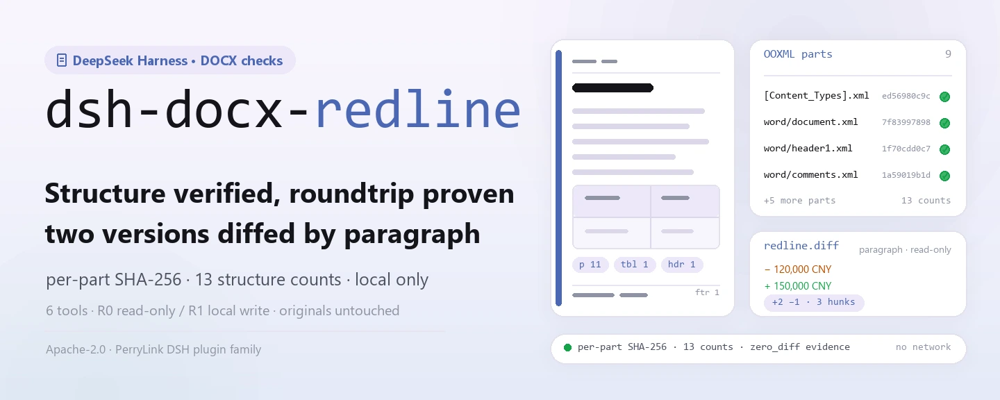
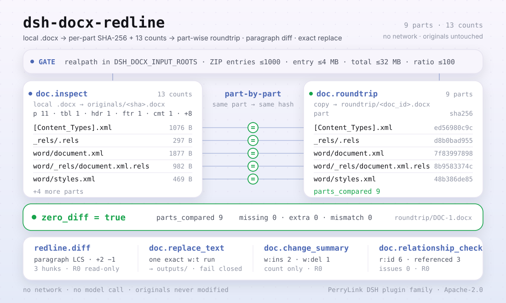

<div align="center">

<picture>
  <source media="(prefers-color-scheme: dark)" srcset="docs/assets/dsh-docx-redline-hero-en-dark.webp">
  
</picture>

# dsh-docx-redline

**Inspecione a estrutura de um DOCX, verifique um roundtrip idêntico parte por parte e compare duas versões parágrafo a parágrafo — tudo local, sem rede.**

Um plugin de inspeção de estrutura DOCX e diff de texto para o DeepSeek Harness: lê pacotes OOXML `.docx` locais, devolve SHA-256 por parte e 13 contagens de estrutura, e adiciona verificação de roundtrip, resumo de revisões, checagem de relações e substituição de texto em uma única execução quando necessário.

[Instalar](#instalação-em-três-passos) · [Configuração](#configuração) · [FAQ](#faq) · [简体中文](README.md) · [English](README.en.md) · [Español](README.es.md) · [Português](README.pt.md) · [हिन्दी](README.hi.md)

[](LICENSE)
[](#compatibilidade)
[](https://www.npmjs.com/package/dsh-docx-redline)
[](https://github.com/PerryLink/dsh-docx-redline/actions/workflows/ci.yml)
[](#compatibilidade)

[](https://github.com/PerryLink/dsh-docx-redline/stargazers)
[](https://www.npmjs.com/package/dsh-docx-redline)
[](https://dshfind.com/plugins/PerryLink/dsh-docx-redline?ref=badge)
[](https://dsh.market/)
[](https://gitee.com/perrylink/dsh-docx-redline)

```sh
dsh plugin --profile <profile> add dsh-docx-redline
```

</div>

<sub>Plugin da comunidade, sem afiliação com a DeepSeek. Repositório canônico: <https://github.com/PerryLink/dsh-docx-redline>; repositórios com o mesmo nome em outras contas não são afiliados. Apache-2.0; o Gitee é um espelho.</sub>

> **Status: alpha / sintético público / parcial / não contabilizado / não GA; ativo novamente desde 2026-11-01.** Sem evidência de clientes, dados de clientes ou promessa de produção.

## O que é

O `dsh-docx-redline` lê um `.docx` local (um pacote ZIP OOXML) e devolve SHA-256 por parte mais 13 contagens de estrutura. Quando necessário, copia o pacote para uma verificação de roundtrip idêntica parte por parte, faz um diff de texto em nível de parágrafo entre dois documentos inspecionados, conta revisões `w:ins` / `w:del`, verifica a integridade das relações do pacote e substitui um run `w:t` sob uma **única correspondência exata**. As seis ferramentas usam namespace `doc.` / `redline.`; não há rede, chamada a modelo nem upload, e o arquivo original nunca é modificado.

- **Adequado para**: comparar o corpo de duas versões de um contrato ou documento oficial; confirmar que um `.docx` recebido está estruturalmente completo (parágrafos, tabelas, cabeçalhos/rodapés, comentários, campos, marcadores); substituir um texto dentro de um limite controlado preservando o original.
- **Não adequado para**: produzir controle de alterações ou aceitar/rejeitar revisões (este pacote não escreve tracked changes); PDFs escaneados ou imagens; documentos criptografados; `.doc` (binário 97-2003).

<picture>
  <source media="(prefers-color-scheme: dark)" srcset="docs/assets/dsh-docx-redline-flow-v5-dark.svg">
  
</picture>

## Instalação em três passos

1. **Instale** (escolha um canal):

   ```sh
   # canal npm (recomendado, versões publicadas)
   dsh plugin --profile <profile> add dsh-docx-redline
   # canal git (último main; lib/ não é versionado, execute antes pnpm install && pnpm build)
   dsh plugin --profile <profile> add github:PerryLink/dsh-docx-redline
   # canal tarball: pnpm pack neste repo e depois
   dsh plugin --profile <profile> add ./dsh-docx-redline-<version>.tgz
   ```

   O pacote npm inclui `lib/` já compilado; o canal git é um snapshot do código com `lib/` no gitignore: compile antes de instalar.

2. **Configuração mínima**: os padrões funcionam — `cordis.patch.yml` insere uma única linha (`id: dsh-docx-redline`) e não há chaves de configuração Schemastery; os únicos ajustes são variáveis de ambiente (ver Configuração).

   ```yaml
   - insert:
       - id: dsh-docx-redline
         name: 'dsh-docx-redline'
   ```

3. **Verifique que montou**:

   ```sh
   dsh --profile <profile> --dump-config | grep dsh-docx-redline
   pnpm build && node samples/quickstart/run.mjs
   ```

   ```
   $ node samples/quickstart/run.mjs
   doc.inspect            DOC-1 parts=9 p=11 tbl=1 hdr=1 ftr=1 comments=1 fields=1 bookmarks=1 warnings=0
   doc.relationship_check relationships=6 referenced=3 external=1 issues=0
   doc.roundtrip          DOC-1 zero_diff=true parts_compared=9
   redline.diff           DOC-1 → DOC-2 added=2 removed=1 hunks=3
   ok: quickstart finished (6 tool calls, roundtrip byte-identical per part)
   ```

   `node samples/quickstart/run.mjs` executa o contrato sintético incluído por inspect → relationship_check → roundtrip → change_summary → diff e compara com o resultado de referência `samples/quickstart/expected/result.json`.

**Desinstalar**: `dsh plugin --profile <profile> remove dsh-docx-redline` (ou remova a linha do patch do profile).

<details>
<summary>Instalar pelo marketplace do DSH Desktop</summary>

Todos os plugins da PerryLink podem ser explorados no marketplace integrado do DSH Desktop: **Marketplace → Fontes → Adicionar fonte → cole** `https://perrylink-dsh-catalog.perrylink.workers.dev/catalog-source.json` **→ selecione**. A instalação continua passando pela verificação de identidade npm do marketplace e pela sua confirmação.

</details>

## Capacidades principais

- **Inspeção de estrutura** — `doc.inspect` lê um `.docx` ZIP/XML local, guarda o original e devolve SHA-256 por parte mais 13 contagens: parágrafos, tabelas, linhas/células de tabela, cabeçalhos/rodapés, notas de rodapé, comentários, campos, marcadores, parágrafos numerados, seções e estilos. O mesmo arquivo é deduplicado por SHA-256, então uma inspeção repetida devolve `existing: true`.
- **Roundtrip parte por parte** — `doc.roundtrip` copia o pacote, descompacta entrada e saída separadamente e compara o hash de cada parte; devolve `zero_diff`, `parts_compared`, partes ausentes/extras e divergências de hash. Nunca compara um arquivo consigo mesmo.
- **Diff em nível de parágrafo** — `redline.diff` faz uma comparação LCS de parágrafos entre dois documentos inspecionados e devolve as contagens de adicionados/removidos e hunks ordenados; somente leitura, sem escrita OOXML e sem tracked changes do Word.
- **Resumo de revisões** — `doc.change_summary` conta `w:ins` / `w:del` e a distribuição por autor; apenas conta, nunca aceita ou rejeita revisões.
- **Integridade de relações** — `doc.relationship_check` verifica que cada `r:id` / `r:embed` / `r:link` de `document.xml` está declarado em `document.xml.rels` e que as partes internas de destino existem; destinos externos são contados à parte. Apenas informa, nunca repara.
- **Substituição limitada** — `doc.replace_text` substitui exatamente um run `w:t` de `word/document.xml` e grava um arquivo novo em `outputs/`; zero ou várias correspondências e texto dividido entre runs falham de forma segura, e o WML gerado é validado antes da gravação.
- **Somente local** — o código não contém chamadas HTTP / DNS / WebSocket; sem rede, sem modelo, sem upload, e os originais nunca são modificados.

### Superfície de ferramentas

Os nomes das ferramentas são a API estável (mantidos em inglês para coincidir com a saída do runtime); as descrições estão localizadas.

| Ferramenta | Finalidade | Risco |
|---|---|---|
| `doc.inspect` | Ler um `.docx` ZIP/XML local, guardar o original e devolver SHA-256 por parte mais contagens de estrutura (parágrafos, tabelas, linhas/células, cabeçalhos/rodapés, notas de rodapé, comentários, campos, marcadores, parágrafos numerados, seções, estilos) | R1 gravação local (guarda o original) |
| `doc.roundtrip` | Copiar o pacote, descompactar os dois lados e comparar o hash de cada parte; devolver um relatório idêntico parte por parte (`zero_diff` / `parts_compared` / ausentes / extras / hash divergente) | R1 gravação local |
| `redline.diff` | Diff de parágrafos em nível de texto (LCS) entre dois documentos inspecionados: parágrafos adicionados/removidos e hunks ordenados; sem escrita OOXML | R0 somente leitura |
| `doc.replace_text` | Substituir um run `w:t` exato em `word/document.xml` e gravar um arquivo novo em `outputs/`; falhar de forma segura quando o texto não é único ou abrange vários runs | R1 gravação local |
| `doc.change_summary` | Contar revisões `w:ins` / `w:del` e autores; sem aceitar/rejeitar | R0 somente leitura |
| `doc.relationship_check` | Verificar que `r:id` / `r:embed` / `r:link` estão declarados em `document.xml.rels` e que as partes internas existem; apenas informa, sem reparar | R0 somente leitura |

### Entradas e saídas

**Entradas**:

- Um `.docx` local (pacote ZIP OOXML; salvo pelo Word / WPS).
- As raízes de entrada são controladas por `DSH_DOCX_INPUT_ROOTS` (várias entradas separadas pelo delimitador de caminhos da plataforma; padrão: cwd do processo host). Os caminhos são resolvidos com `realpath` e precisam ficar dentro de uma raiz configurada.
- Limites de segurança ZIP: ≤1000 entradas, ≤4 MB por entrada após descompactar, ≤32 MB descompactado no total, proporção de compressão ≤100 (para entradas acima de 1 MB); portanto, um arquivo deve ficar claramente abaixo de 32 MB descompactado.
- Amostras incluídas: `samples/quickstart/input/contract-v1.docx` e `contract-v2.docx` (cerca de 4 KB cada; contrato sintético com partes e valores fictícios, sem documento de cliente).

**Saídas**:

- Contagens de estrutura e SHA-256 por parte, relatório de roundtrip, resumo de revisões, diff por parágrafos e um `.docx` novo para as substituições.
- Gravados em `$DSH_HOME/storages/dsh-docx-redline` (ou `DSH_DOCX_HOME`): `originals/` (cópias do original nomeadas por sha256), `roundtrip/` (cópias do roundtrip) e `outputs/` (artefatos de substituição).
- O arquivo original nunca é modificado.

### Exemplos

Cole este prompt no assistente (tradução em português do prompt de demonstração incluído em `package.json`):

```text
Revise a estrutura do contrato de exemplo incluído, compare com a versão final e me diga quais parágrafos mudaram e quantas revisões existem.
```

Você também pode executar por conta própria (execução real; a captura vem deste comando):

```sh
pnpm build && node samples/quickstart/run.mjs
```


*Comando real `node samples/quickstart/run.mjs` nos dois DOCX sintéticos incluídos: 6 chamadas de ferramenta. A imagem é um render 1:1 de `samples/quickstart/expected/console.txt`; nada foi redigitado.*

Exemplo com fixture: entrada [`fixtures/public/python-docx/blk-containing-table.docx`](https://github.com/PerryLink/dsh-docx-redline/blob/main/fixtures/public/python-docx/blk-containing-table.docx) (amostra pública MIT); comando `pnpm test`.

Aceitação: `node scripts/acceptance.mjs` gera `ACCEPTANCE.csv` (6 linhas; as linhas SKU são `counted=false`, a linha da amostra incluída `PS1-QS01` é `counted=true`):

```csv
req_id,metric,threshold,actual,script,evidence_sha256,pass,source,counted
SKU-01-A01,无改动往返通过率（20 合成）,100%,1,scripts/acceptance.mjs,2140bb443d8d3b36790ba67eec101ca86f2754f530b428758a5ed7890a1b44cd,true,public/synthetic,false
SKU-01-A02,结构覆盖（6 类）,6/6,6,scripts/acceptance.mjs,2140bb443d8d3b36790ba67eec101ca86f2754f530b428758a5ed7890a1b44cd,true,public/synthetic,false
SKU-01-A03,畸形拒绝率（5 份）,100%,1,scripts/acceptance.mjs,2140bb443d8d3b36790ba67eec101ca86f2754f530b428758a5ed7890a1b44cd,true,public/synthetic,false
SKU-01-A04,修订统计（w:ins/w:del）,2/1,2/1,scripts/acceptance.mjs,2140bb443d8d3b36790ba67eec101ca86f2754f530b428758a5ed7890a1b44cd,true,public/synthetic,false
SKU-01-A05,OOXML 关系完整性,0 issues,0,scripts/acceptance.mjs,2140bb443d8d3b36790ba67eec101ca86f2754f530b428758a5ed7890a1b44cd,true,public/synthetic,false
PS1-QS01,quickstart 样例与金标一致,1/1,1,scripts/acceptance.mjs,1271d470260bec05ea4e2bf2916fb07305e9e4b540ebf65af17a9c9924dcda30,true,synthetic/quickstart,true
```

*O conjunto sintético contém 20 DOCX válidos (parágrafos, tabelas, cabeçalhos/rodapés, notas de rodapé, comentários, campos, marcadores, numeração, seções, estilos) e 5 pacotes malformados; a evidência de cliente é de 0 pares. Ver [`EVIDENCE.md`](EVIDENCE.md) e [`APPROVAL-AND-EVIDENCE.md`](APPROVAL-AND-EVIDENCE.md).*

## Configuração

Este plugin não tem chaves de configuração Schemastery: `cordis.patch.yml` insere uma única linha e os padrões funcionam. Os ajustes são variáveis de ambiente:

| Chave | Padrão | Significado |
|---|---|---|
| `DSH_DOCX_HOME` | `$DSH_HOME/storages/dsh-docx-redline` | Raiz de armazenamento: `originals/`, `roundtrip/` e `outputs/` ficam aqui; se `$DSH_HOME` não estiver definido, cai em `storages/dsh-docx-redline` sob o cwd do processo host |
| `DSH_DOCX_INPUT_ROOTS` | cwd do processo host | Raízes de entrada permitidas, várias separadas por `path.delimiter` (Windows `;`, POSIX `:`); validadas com realpath |
| `DSH_HOME` | cwd do processo host | Usado apenas para derivar o `DSH_DOCX_HOME` padrão; ignorado quando `DSH_DOCX_HOME` é definido explicitamente |

<details>
<summary>Superfície de montagem e padrões</summary>

`cordis.patch.yml` (completo):

```yaml
- insert:
    - id: dsh-docx-redline
      name: 'dsh-docx-redline'
```

- O plugin declara `inject = ['tools', 'storageDomain']`: os dois serviços precisam estar presentes ou o plugin não monta; um `storageDomain` ausente nunca degrada em silêncio.
- As ferramentas registram em `ctx.tools`; `doc.inspect` grava o original, `doc.roundtrip` grava uma cópia e `doc.replace_text` grava em `outputs/`; as outras três são somente leitura.
- `doc_id` é criado por `doc.inspect` e guardado na tabela `documents` do domínio `docx` da sessão; uma sessão nova ou uma inspeção pulada deixa esse registro inexistente.

</details>

## FAQ

<details>
<summary>Não instala ou não monta. O que fazer?</summary>

Verifique se `node --version` é ≥24.9 e <25 e se `dsh --version` está dentro de `>=0.2.1-rc.3 <0.4.0`; depois execute `dsh plugin --profile <profile> add dsh-docx-redline`. O host precisa fornecer `tools` e `storageDomain` (dependência dura); se faltar um, o plugin não monta. A tabela completa de erros está em [`TROUBLESHOOTING.md`](TROUBLESHOOTING.md).

</details>

<details>
<summary>Pode danificar meu documento?</summary>

Não há escrita no original. `doc.inspect` apenas copia o original para `originals/`, `doc.roundtrip` apenas grava uma cópia em `roundtrip/` e `doc.replace_text` apenas grava um arquivo novo em `outputs/`. A substituição exige que o texto alvo seja **único** em `word/document.xml`; zero ou várias correspondências e texto dividido entre runs falham de forma segura, e o WML gerado é validado antes da gravação.

</details>

<details>
<summary>Suporta .doc, PDF, documentos criptografados ou digitalizações?</summary>

Não. Apenas `.docx` padrão (pacote ZIP OOXML, salvo pelo Word/WPS); `.doc` (binário 97-2003), PDF, documentos criptografados e digitalizações só de imagem ficam fora. Remova a senha primeiro ou salve outros formatos como `.docx`.

</details>

<details>
<summary>O resultado não bate ou ele avisa de cabeçalhos/rodapés ausentes. Por quê?</summary>

Veja primeiro `warnings`: ausência de cabeçalho/rodapé, campos, marcadores, numeração ou comentários é informada separadamente. O diff é de **texto em nível de parágrafo**, não revisões em nível de caractere; o texto excluído (`w:delText`) não faz parte do corpo atual. `doc.relationship_check` apenas informa `E_DOC_REL_UNRESOLVED` / `E_DOC_REL_MISSING_PART` e não repara — abrir e salvar novamente no Word costuma corrigir as relações.

</details>

<details>
<summary>Onde meus dados ficam? Algo é enviado?</summary>

Apenas em `$DSH_HOME/storages/dsh-docx-redline` (ou `DSH_DOCX_HOME`): cópias do original, cópias do roundtrip e `outputs/*.docx`. O código não faz chamadas de rede; nada é enviado e nenhum modelo é chamado. O repositório contém apenas fixtures públicas/sintéticas, sem dados de clientes.

</details>

## Limites de segurança

- **Escopo de leitura**: apenas os `.docx` que você passa explicitamente dentro de `DSH_DOCX_INPUT_ROOTS` (cwd por padrão); os caminhos são resolvidos com `realpath` e verificados, e uma saída devolve `E_DOC_PATH_NOT_ALLOWED`.
- **Escopo de escrita**: apenas a raiz de armazenamento do `dsh-docx-redline` (`originals/`, `roundtrip/`, `outputs/`); os originais nunca são modificados.
- **Sem rede**: nenhuma chamada HTTP / DNS / WebSocket no código; sem sistemas externos e sem upload.
- **Proteção contra ZIP bombs**: toda leitura passa por `safeUnzip()` com limites antes da descompactação (>1000 entradas, >4 MB por entrada, >32 MB descompactado, proporção >100 → `E_DOC_ZIP_LIMIT`), e os tamanhos reais são revistos após inflar.
- **Substituição fail-closed**: `doc.replace_text` aceita apenas uma correspondência exata; a substituição em forma de função mantém `$&`, `$1` e similares como literais; o WML gerado é validado com `XMLValidator` / `XMLParser` e rejeitado antes de gravar se for inválido.
- **Prova de roundtrip**: `doc.roundtrip` descompacta entrada e saída e compara o hash de cada parte em vez de comparar um pacote consigo mesmo.
- **Hashes de evidência**: o SHA-256 do original, o SHA-256 por parte e o `evidence_sha256` do registro são reproduzíveis.
- **Níveis de risco**: ferramentas que gravam são R1 (gravação local); as somente leitura são R0; ver a tabela de ferramentas em Capacidades principais.
- **Checagem de relações somente leitura**: `doc.relationship_check` devolve issues e nunca modifica o pacote.

## Permissões e dados

```text
leitura: apenas os .docx que você indica dentro das raízes de entrada; sem percorrer outros diretórios
escrita: $DSH_HOME/storages/dsh-docx-redline (originais, cópias de roundtrip, outputs/*.docx); original intacto
rede: não
sistemas externos: nenhum
```

- Executa localmente; sem rede, sem chamada a modelo, sem upload.
- Apenas fixtures públicas/sintéticas; sem dados ou evidência de clientes.
- Alpha / parcial; não contabilizado, sem GA ou promessa de produção.
- Manutenção ativa: trabalho retomado em 2026-11-01; novos recursos e endurecimento chegam em versões alpha.

## Limitações conhecidas

- **Apenas validação pública/sintética.** Alpha / parcial / não contabilizado / não GA; a evidência de cliente é de 0 pares reais de DOCX em duas versões e 0 DOCX malformados, e o E2 doc-core não é entregue. Isso não estabelece precisão com clientes, fidelidade Word/LibreOffice, precisão de posição de revisões nem prontidão GA.
- **Nível de texto, não de caractere.** `redline.diff` compara parágrafos como texto, não revisões caractere a caractere; o texto excluído (`w:delText`) não faz parte do corpo atual.
- **Sem tracked changes.** Não gera controle de alterações do Word nem aceita/rejeita revisões; `doc.change_summary` apenas conta `w:ins` / `w:del`.
- **Superfície de substituição estreita.** `doc.replace_text` trabalha com um único run `w:t` exato; texto não único, zero correspondências e texto dividido entre runs falham; comentários e campos fora do texto correspondido ficam intactos.
- **A checagem de relações não repara.** `doc.relationship_check` apenas informa referências não declaradas e destinos ausentes; reparar exige salvar novamente no Word ou editar o pacote.
- **Limites de formato.** Sem `.doc` (binário 97-2003), PDF, documentos criptografados, digitalizações ou imagens; remova antes a senha dos arquivos criptografados.
- **Limites ZIP.** ≤1000 entradas, ≤4 MB por entrada após descompactar, ≤32 MB descompactado, proporção ≤100 (para entradas acima de 1 MB); documentos enormes precisam ser divididos antes.
- **Limite de raiz de entrada.** As ferramentas leem apenas arquivos sob `DSH_DOCX_INPUT_ROOTS` (cwd por padrão); um caminho fora da raiz é rejeitado.
- **Sem UI nem metade cliente.** Plugin puro de host, sem interface de navegador, pré-visualização ou painel de comentários; todos os resultados voltam pela saída das ferramentas.

## Compatibilidade

| Superfície | Status |
|---|---|
| Harness | `dsh >=0.2.1-rc.3 <0.4.0` |
| Node | `>=24.9.0 <25` |
| Plataformas | Onde o DSH rodar; apenas arquivos locais |
| Dados | Sem rede, sem chamada a modelo, sem upload |

## Ecossistema e qualidade

- [Espelho Gitee](https://gitee.com/perrylink/dsh-docx-redline) (espelho sincronizado; o GitHub é canônico)
- [Página dshfind](https://dshfind.com/plugins/PerryLink/dsh-docx-redline) (instalações e ranking)
- [DSH Market](https://dsh.market/) (listado)
- **Canal da loja 1024**: execute `npm i -g dsh1024` e depois `dsh1024 plugin --profile <profile> add dsh-docx-redline` (conta para o ranking do [deepseek1024.com](https://deepseek1024.com))
- Documentação: [`TROUBLESHOOTING.md`](TROUBLESHOOTING.md) · [`PRIVACY.md`](PRIVACY.md) · [`SECURITY.md`](SECURITY.md) · [`ACCEPTANCE.csv`](ACCEPTANCE.csv) · [`EVIDENCE.md`](EVIDENCE.md) · [`APPROVAL-AND-EVIDENCE.md`](APPROVAL-AND-EVIDENCE.md)
- Índices de família: [índice de domínio](https://perrylink.github.io/dsh-plugins/) · [família de checkers](https://perrylink.github.io/zh/checkers/) · [família principal](https://github.com/PerryLink/dsh-kit)
- Pacotes irmãos: [dsh-ifc-qto](https://github.com/PerryLink/dsh-ifc-qto) · [dsh-legal-clause](https://github.com/PerryLink/dsh-legal-clause) · [dsh-contract-suite](https://github.com/PerryLink/dsh-contract-suite)

Verificadores relacionados (cada um é um pacote independente com seu próprio rule pack e versão; instale só os que precisar):

| Pacote | Por que é relevante |
|---|---|
| [`dsh-gongwen-word-check`](https://github.com/PerryLink/dsh-gongwen-word-check) | Elementos de formatação de documentos oficiais. |
| [`dsh-archive-check`](https://github.com/PerryLink/dsh-archive-check) | Registro de arquivo e prazos de retenção. |
| [`dsh-paper-doc-adapter`](https://github.com/PerryLink/dsh-paper-doc-adapter) | Consistência estrutural de provas parseadas. |

## Desenvolvimento

```sh
pnpm install --frozen-lockfile
pnpm build && pnpm lint && pnpm typecheck && pnpm test
pnpm run gate:sku01
node scripts/acceptance.mjs
pnpm run pack:check
node samples/quickstart/run.mjs
```

`pnpm test` compila com `tsc` e depois executa `node --test test/*.test.mjs` (docx / public-docx / change-summary / relationships / security / plugin-smoke). `pnpm run gate:sku01` e `scripts/acceptance.mjs` produzem/verificam as linhas de aceitação.

| Caminho | Conteúdo |
|---|---|
| `src/core/docx.ts` | Tipos, códigos de erro e constantes de limites ZIP |
| `src/adapters/docx-zip.ts` | Leitura OOXML ZIP, parsing de estrutura, hashes por parte, substituição, resumo de revisões, checagem de relações |
| `src/plugin/index.ts` | Entrada host: lê variáveis de ambiente, abre o domínio `docx`, registra as seis ferramentas |
| `src/plugin/storage.ts` | Domínio de armazenamento `docx` (tabela `documents`) e gravação do original |
| `src/plugin/tools.ts` | Definições das seis ferramentas |
| `test/` | Casos de `node --test` |
| `fixtures/public/python-docx/` | 8 amostras DOCX públicas com licença MIT (com LICENSE / SOURCE) |
| `samples/quickstart/` | Contrato sintético v1/v2, script de execução e saída de referência |
| `scripts/` | lint, aceitação, gate, checagem de pack, geração de amostras e imagens |
| `docs/assets/` | WebPs do hero, SVG de estrutura e capturas reais |

O hero e o diagrama de estrutura são gerados por [`scripts/gen-readme-assets.py`](scripts/gen-readme-assets.py) (Python + Pillow para o hero WebP, SVG escrito à mão para o diagrama) e podem ser reexecutados; `quickstart.png` é um render 1:1 de `samples/quickstart/expected/console.txt`.

Topics: `deepseek-harness`, `dsh`, `dsh-plugin`, `docx`, `redline`, `docx-inspect`, `perrylink`, `ooxml`, `document`

## Família e agradecimentos

Este projeto é membro da família de plugins do DeepSeek Harness mantida pela [PerryLink](https://github.com/PerryLink) (todos Apache-2.0). Se este plugin ajudar você, **deixe uma estrela** — não desbloqueia nada, mas faz a próxima pessoa encontrá-lo mais facilmente.

- [@PerryLink](https://github.com/PerryLink) — criador e mantenedor: leitura de estrutura OOXML, roundtrip com hash por parte, diff por parágrafos, substituição limitada de `w:t`, resumo de revisões, checagem de relações do pacote e documentação em cinco idiomas.

## Licença

[LICENSE](LICENSE) (Apache License 2.0) © 2026 PerryLink; veja também `NOTICE` e `THIRD-PARTY-NOTICES`.

<p align="center"><sub>Apache-2.0 · plugin da comunidade, sem afiliação com a DeepSeek.</sub></p>
